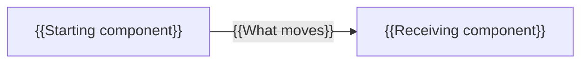

# Module {{MODULE_NUMBER}}: {{MODULE_TITLE}}

> Authoring template: replace every `{{...}}` value and remove this note.
> Retain the section headings so the shared checker can identify the structure.

## Purpose and outcomes

{{Explain the scenario problem and what this module prepares the learner to do.}}

By the end, you can:

- {{Observable outcome, not "understand the technology".}}
- {{A second outcome demonstrated by evidence.}}

## Starting point

| Requirement | State needed |
| --- | --- |
| Prior learning | {{Prior module links or introductory reading}} |
| Working directory | {{Workshop convention, used by all commands below}} |
| Tools and services | {{Setup link, selected track, active services and readiness check}} |
| Data and variables | {{Required state and how to obtain/reset it; do not assume hidden IDs}} |

{{List any costs or permissions specific to this module at the relevant step.}}

## Concept introduction

{{Explain terms and mechanics before commands rely on them. Give a worked example.}}

{{Explain the arrows and any simplified behavior. Ask a short prediction question.}}

## Guided lab

### Step 1: {{Action}}

{{Explain what the action changes and where it runs. Supply explicit commands
for supported shells, or common source plus shell-specific launch instructions.}}

**Expected observation:** {{Actual output shape or behavior, including variable values.}}

### Step 2: {{Action building on the first}}

{{Commands or learner actions.}}

**Expected observation:** {{What should happen and why.}}

## Independent exercise

{{Give a bounded problem requiring the learner to apply the concept with less help.
Specify input/output, starting file if needed, constraints, and acceptance criteria.
Do not paste the completed solution into the task. Foundations can use a paper task.}}

## Failure or variation

{{State the predicted failure/changed condition, the action to trigger it, the
expected result, and whether state should change. Link it to the module's concept.}}

## Verification and evidence

| Claim | Evidence to collect | Passing result |
| --- | --- | --- |
| {{Outcome}} | {{Command/output/observation}} | {{Measurable behavior}} |
| {{Failure boundary}} | {{State before and after}} | {{Expected unchanged or recovered state}} |

{{Ask for interpretation rather than just copying output.}}

## Troubleshooting

| Symptom | Check and recovery |
| --- | --- |
| {{Likely failure}} | {{Smallest boundary to inspect and a targeted corrective action}} |

## Reset and handoff

{{State what to stop/reset, exact scope and effects, what must be kept, and which
IDs/files/variables the next module expects. Link to the next module.}}

## Knowledge check

1. {{Question requiring reasoning about the concept.}}
2. {{Question connecting an observed failure to its cause.}}

## Reference implementation

{{Link to a separate completed example or solution for review after the attempt.
For conceptual tasks, link to separate worked reasoning or a comparison rubric.}}
