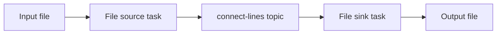

# Enterprise extensions

The [main guide](../training-guide.md) is the prerequisite. Commands run from the
repository root using its `$Single` and `$Python` variables.
Only extension A is a runnable integration lab in this release. B-D are explicitly
design exercises for deeper follow-on workshops, not claims of deployed features.

## A. A small Kafka Connect integration (30-45 minutes)

**Objective:** Move data through Kafka without writing a custom producer or sink.
Use the **single-broker** environment for this lab.

Kafka Connect is a separate worker process with connector plugins and tasks.
The official Kafka JVM image includes demonstration file connectors. They are
useful for learning, not an enterprise file-ingestion recommendation.



### Prepare

```powershell
docker compose -f $Single up -d --wait --wait-timeout 180
docker compose -f $Single exec -T kafka /opt/kafka/bin/kafka-topics.sh --bootstrap-server kafka:19092 --create --topic connect-lines --partitions 1 --replication-factor 1
docker compose -f $Single cp kafka\infrastructure\connect\worker.properties kafka:/tmp/training-worker.properties
docker compose -f $Single cp kafka\infrastructure\connect\file-source.properties kafka:/tmp/training-source.properties
docker compose -f $Single cp kafka\infrastructure\connect\file-sink.properties kafka:/tmp/training-sink.properties
docker compose -f $Single exec -T kafka sh -c 'touch /tmp/kafka-training-input.txt'
```

On macOS/Linux, use `/` in the three local configuration paths. Files in `/tmp`
are intentionally ephemeral and are not stored in the Kafka data volume.
If `connect-lines` already exists, inspect it instead of creating it again.

### Start the worker

In a dedicated terminal, run in the foreground:

```powershell
docker compose -f $Single exec kafka /opt/kafka/bin/connect-standalone.sh /tmp/training-worker.properties /tmp/training-source.properties /tmp/training-sink.properties
```

This command intentionally keeps an interactive terminal attached so Ctrl+C can
interrupt the worker. Keep it running. In another terminal, wait until the worker responds:

```powershell
docker compose -f $Single exec -T kafka bash -c 'exec 3<>/dev/tcp/127.0.0.1/8083; printf "GET /connectors/training-file-source/status HTTP/1.0\r\nHost: localhost\r\n\r\n" >&3; cat <&3'
docker compose -f $Single exec -T kafka bash -c 'exec 3<>/dev/tcp/127.0.0.1/8083; printf "GET /connectors/training-file-sink/status HTTP/1.0\r\nHost: localhost\r\n\r\n" >&3; cat <&3'
```

These commands use the image's Bash TCP support because the pinned image does
not include `curl`; they print the raw HTTP response.

**Expected:** HTTP `200 OK`, with connector and task states `RUNNING`. If the worker is still
starting, wait and retry. A connector can exist while one of its tasks is `FAILED`;
check both levels and the worker logs.

The REST API listens only on loopback **inside the container**; no REST port is
published to the host. This standalone worker shares a container with the broker
solely to keep the workshop small.

### Move data and inspect it

```powershell
docker compose -f $Single exec -T kafka sh -c 'printf "order-a\norder-b\n" >> /tmp/kafka-training-input.txt'
Start-Sleep -Seconds 5
docker compose -f $Single exec -T kafka cat /tmp/kafka-training-output.txt
docker compose -f $Single exec -T kafka /opt/kafka/bin/kafka-console-consumer.sh --bootstrap-server kafka:19092 --topic connect-lines --from-beginning --max-messages 2 --timeout-ms 15000
```

**Verify:** Both lines appear in the topic and sink file. Append a third line:

```powershell
docker compose -f $Single exec -T kafka sh -c 'printf "order-c\n" >> /tmp/kafka-training-input.txt'
Start-Sleep -Seconds 5
docker compose -f $Single exec -T kafka cat /tmp/kafka-training-output.txt
```

If output is not present after five seconds, inspect connector/task status and
worker logs; the sleep is a convenience, not a delivery guarantee.

### Restart and explain

Stop the foreground worker with Ctrl+C, restart it with the same command, and
append a fourth line. Inspect the sink and worker logs.

The source tracks file positions in a local offset file. The sink uses Kafka
consumer-group positions. Observe restart behavior, but do not infer exactly-once
file output: duplicates are possible around failures.

**Troubleshooting:** `Class ... could not be found` indicates the plugin path or
image differs from the pinned baseline. `FAILED` task state requires reading its
trace. Missing source files, file permissions, converters, and missing topics are
common causes. The Connect API does not provide production security in this lab.

**Cleanup:** Stop the worker with Ctrl+C before stopping its container. The lab's
`/tmp/kafka-training-*` files disappear when the container is removed by Compose
`down`. The `connect-lines` topic persists until explicitly deleted or its volume
is erased. Repeating the lab against existing files/topics can repeat output.

**Enterprise discussion:** Real connectors have their own installation, support,
licensing, schemas, authentication, and delivery guarantees. Distributed Connect
uses Kafka-backed configuration/offset/status topics and worker coordination.
Running more tasks than the connector or source can parallelize does not create
useful throughput automatically. Secure and monitor workers and the REST API.

## B. Contract evolution design exercise (30 minutes)

**Objective:** Plan a change without breaking independently deployed consumers.

Current event contract: integer `schema_version=1`, string IDs, integer
`amount_cents`, timestamp with timezone, and a known status. The sample validator
accepts extra fields but rejects unsupported versions/statuses.

For each change, predict old-consumer behavior and propose a rollout:

| Change | Question to resolve |
| --- | --- |
| Add optional `sales_channel` | Is absence supported? Is there a meaningful default? |
| Rename `order_id` | Can both fields coexist during migration? What happens to the Kafka key? |
| Change `amount_cents` to a string | Which consumers/aggregations break? Is a new field preferable? |
| Add `cancelled` status | Can old state machines safely handle it, even if a registry permits the string? |
| Add customer email | Is personal data necessary in an immutable retained stream? |

**Deliverable:** A compatibility matrix, producer/consumer deployment order, rollback
strategy, and data-classification decision.

For a future implementation lab, choose an approved registry, pin its image and
serializers, define a schema, set compatibility policy, and prove that a breaking
change is rejected. Registry-backed wire formats differ from the plain JSON in
this workshop; changing only the producer would break the existing consumer.
Do not claim registry enforcement until that path has been implemented and exercised.

## C. Transactions and outbox design exercise (30 minutes)

**Objective:** Identify atomicity boundaries.

Sketch consume-transform-produce using Kafka transactions:

1. Assign an appropriate, fenced `transactional.id` to each producer instance.
2. Begin a transaction and produce derived Kafka records.
3. Send consumed offsets to that transaction using current group metadata.
4. Commit or abort with documented recovery handling.
5. Configure downstream consumers with `isolation.level=read_committed`.

**Verify conceptually:** An aborted transaction must not expose derived records to
`read_committed` consumers or advance consumed offsets as a committed result.
A live extension must test aborts, restarts, fencing, and rebalances, not only the
happy path.

Now add a payment API or SQL database update. It is not automatically enlisted in
Kafka's transaction. Propose an idempotency key and/or transactional outbox with a
relay and reconciliation. Explain duplicate handling on both sides.

## D. Stream-processing design exercise (30 minutes)

**Objective:** Design analytics based on event time rather than arrival order.

Design "paid order value per five-minute window" and define:

- The key, window boundaries, event timestamp, and allowed lateness.
- Behavior for duplicate event IDs and out-of-order status transitions.
- Whether a late event corrects a prior result or goes to a side output.
- State storage, changelog/recovery, repartitioning, and failure handling.

Kafka Streams is a JVM library; it is not part of this Python example. Other stream
processors have different operational models. A future implementation should pin
one framework and verify deterministic results with late and duplicate input,
rather than presenting a simple Python poll loop as equivalent stateful processing.
