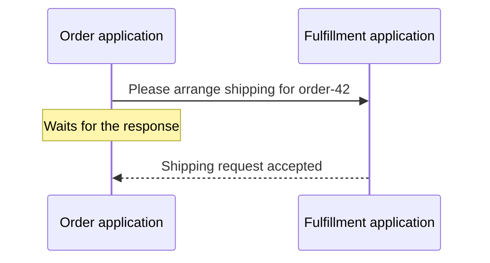
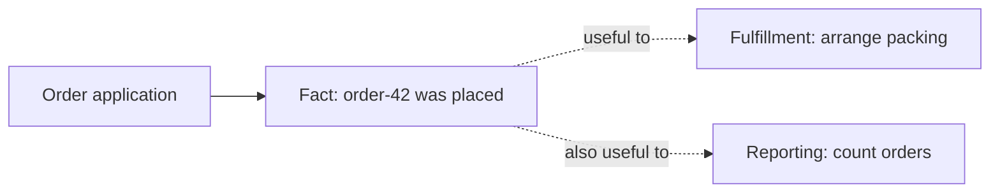
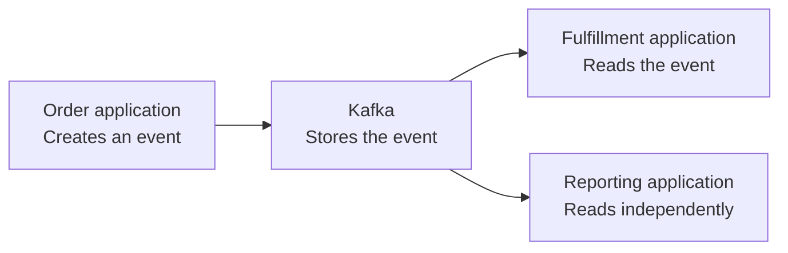
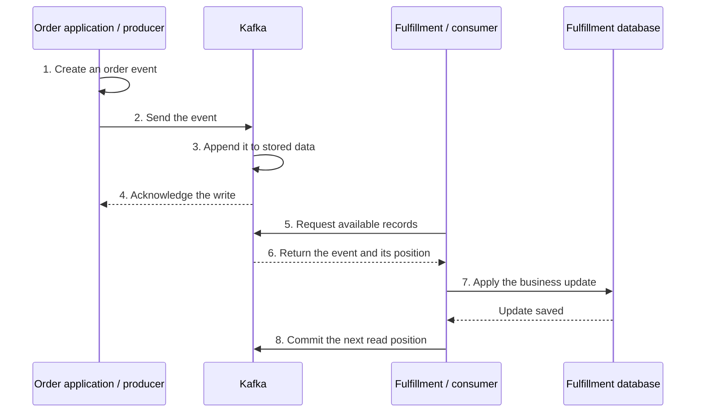
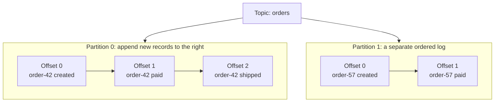
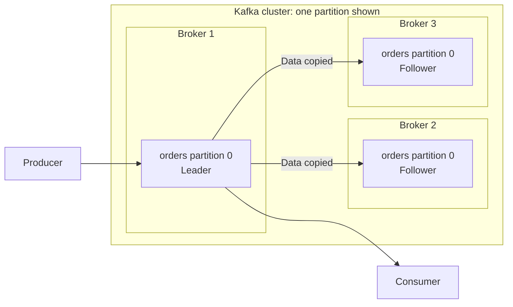
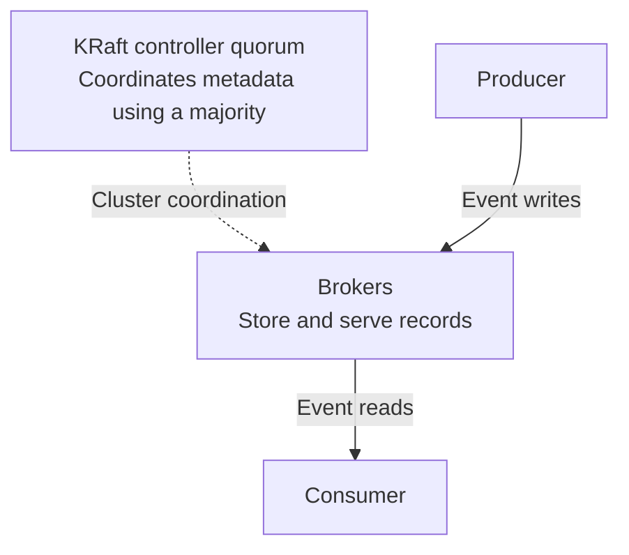
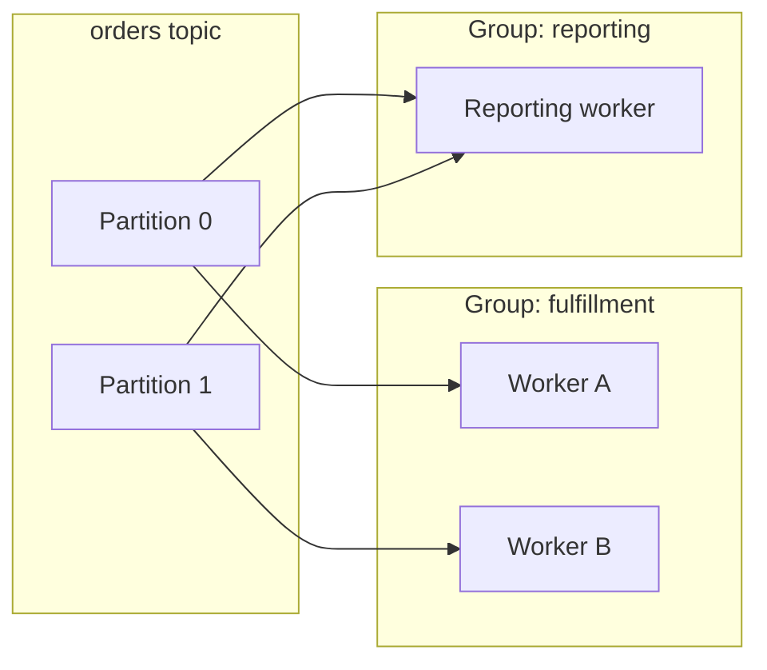
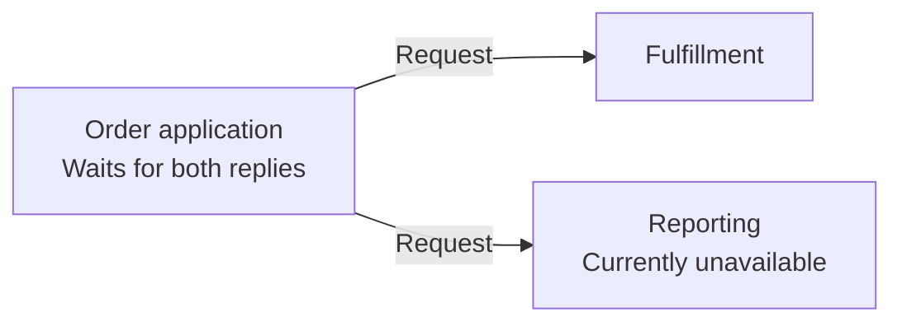
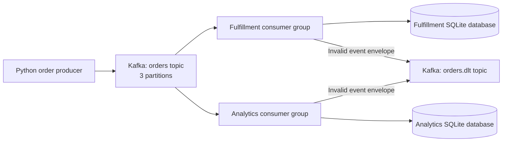

# Apache Kafka hands-on workshop

## How to use this guide

Work through modules 1-10 in order, then complete the enterprise discussion and
capstone. You will build a synthetic order-processing system, inspect its behavior,
and deliberately introduce failures. No knowledge of enterprise systems or
distributed applications is assumed: module 1 builds that background before you
install or run anything.

**Learning contract:** For each lab, record what you expected, what happened, and
why. A running command is not sufficient evidence of understanding.

### Outcomes and schedule

For beginners, allow **three days**, including discussion, breaks, and troubleshooting:

| Session | Modules | Outcome |
| --- | --- | --- |
| Day 1 morning | 1 and environment preparation | Build a mental model of Kafka, then prepare the tools |
| Day 1 afternoon | 2-4 | Run Kafka and build working clients |
| Day 2 morning | 5-7 | Explain keys, scale consumers, inspect and replay offsets |
| Day 2 afternoon | 8-9 | Handle duplicates, quarantine failures, explore retention |
| Day 3 morning | 10-11 | Observe broker failure and connect Kafka to other systems |
| Day 3 afternoon | 12 and capstone | Review enterprise readiness and demonstrate the complete solution |

A compressed **two-day path** suits learners already comfortable with application
architecture: cover modules 1-4 on the first morning, 5-7 that afternoon, 8-10 on
the second morning, and 11-12 plus the capstone that afternoon. Assign the
foundations reading in advance and demonstrate the longer failure/compaction
exercises if necessary; do not rush beginners through the same schedule.

This is a guided developer workshop, not a production administrator certification.
The [optional extensions](labs/enterprise-extensions.md) deepen selected topics.

## 1. Understanding Kafka: from a simple message to a distributed system (90-120 minutes)

**Objective:** Explain what Kafka is, follow an event through it, recognize its
main building blocks, and choose when to use it before writing any commands.

Work through this module with a notebook or whiteboard. Each picture adds one
idea to the same online-shop story. You do not need a running Kafka environment.

### 1.1 Applications need to communicate

An **application** is a program that performs useful work. Our order application
accepts purchases. A fulfillment application arranges packing and shipping. Each
can have a **database**: a place to store and query its business information.

A **service** is an application component that exposes a capability to other
programs, often through an **API**, an agreed way to request work or information.
An enterprise system is not a special kind of computer: it commonly consists of
many such applications supporting an organization's work.

Start with two programs communicating directly:



This is a **synchronous request**: the caller waits for a response. It is often
exactly what we need, for example when a customer asks for the current order status.
If fulfillment is slow or unavailable, however, the caller must decide whether to
wait, retry, or report failure.

**Check your understanding:** Name the caller and the receiver. What does the
caller know if it times out: that shipping failed, or only that no response arrived?

### 1.2 What is an event?

A request says, "Please do this." An **event** says, "This happened." For example,
"Order order-42 was placed" describes a fact that other applications might find useful.

An event is data, not executable instructions. A small illustrative event is:

```json
{
  "event_id": "event-1001",
  "order_id": "order-42",
  "status": "created",
  "occurred_at": "2026-01-01T10:00:00+00:00"
}
```

The event ID identifies this occurrence; the order ID identifies the business
object. The same order can later have different events, such as paid or shipped.
The runnable clients add a schema version and amount to this introductory example.



This picture shows who is interested, not how the event reaches them. We need
somewhere to store the event and a way for each application to read it.

**Check your understanding:** Which is an event: "Charge this card" or "Payment
was received"? Would placing and shipping one order normally use the same event ID?

### 1.3 What is Kafka?

**Apache Kafka is a distributed event-streaming platform.** In simpler terms, it
lets applications write a continuing sequence of events, stores those events,
and lets other applications read them at their own pace.

An **event stream** is that continuing sequence over time. **Distributed** means
Kafka can spread its work and stored data across multiple servers; we will first
learn with just one.



An application writing events is a **producer**. An application reading events is
a **consumer**. A Kafka **client** is the library an application uses to communicate
with Kafka; later, our Python programs will use one.

Think of a shared journal: a writer adds entries, and different readers keep their
own bookmarks. Unlike handing a note to one person, reading an entry does not
remove it. The analogy has limits: Kafka splits journals into partitions, manages
network failures, and removes data according to configured policies.

Kafka does not pack orders, update your business database automatically, or decide
what a message means. Those are application responsibilities. Consumers request
records from Kafka; the arrows above show data flow, not Kafka calling their APIs.

**Check your understanding:** If reporting reads an event first, can fulfillment
still read it? Which program actually performs the fulfillment work?

### 1.4 Follow one event from creation to processing

Follow `order-42` through a simplified successful interaction. An **acknowledgment**
is the broker's confirmation that a write met the configured requirements.



The producer's acknowledgment does **not** mean fulfillment has completed. It
confirms a Kafka write, with durability dependent on configuration. Fulfillment
may process the event later: this is **asynchronous** communication.

The final step saves the consumer's progress, rather like updating a bookmark.
If the consumer fails after saving its database update but before saving progress,
it may read the same event again. We will deliberately reproduce that case and
avoid repeating the database effect in module 8.

The order database, if present, is separate from the fulfillment database shown
here. Saving an order and publishing its event are not automatically one atomic
operation. Our first producer generates synthetic events; module 11 introduces
the outbox pattern for that real-world integration problem.

**Check your understanding:** At step 4, can the producer tell the customer that
the order has shipped? Why might fulfillment see the same event twice?

### 1.5 How Kafka organizes information

A **topic** is a named stream, such as `orders`. Rather than keeping a large topic
in one sequence, Kafka divides it into **partitions**. Each partition is an
ordered log: new records are appended at the end.

An **offset** is a record's position within one partition. It is not a global
message number or the business event ID.



The arrows within each partition show log order, not messages traveling between
applications. Offset 0 in partition 0 and offset 0 in partition 1 are different
records. There is no single ordering across both partitions.

A record's **key** can identify the order. With consistent key-based partitioning
and an unchanged partition count, events with the same key go to the same
partition. That lets us preserve the sequence Kafka receives for that order.
The exact partition numbers above are illustrative, not promised hash results.
Kafka does not correct events that independent producers send in the wrong
business order.

The record's **value** is its content, such as JSON. It also has a timestamp and
can have **headers**, small pieces of metadata such as an event type.

Readers keep positions separately. To make bookmarks concrete, consider just
partition 0, whose current end position is 3:

| Reader | Committed next offset | Remaining records in this example |
| --- | --- | --- |
| Fulfillment | 3 | None |
| Reporting | 1 | Offsets 1 and 2 |

Reporting can catch up without making fulfillment reread anything. Its committed
**lag** is two records in this example. Record lag is not elapsed time: two slow
records could take longer than a thousand fast ones.

**Retention** controls how long or how much data Kafka keeps. For a delete-policy
topic with seven-day retention, reading an event does not remove it, but a reader
that falls too far behind can miss data when old segments are removed.
**Replay** means moving a reader back to available earlier records, or starting
a new reader there. Kafka cannot replay data that has already been deleted.
Module 9 introduces a different cleanup policy, compaction, for keyed state.

**Paper exercise:** Add a fourth event to partition 0. What is its offset? How
many unread records does reporting now have? Answers: offset 3 and three records,
assuming neither reader advances.

### 1.6 How Kafka is built

A **broker** is a Kafka server process that stores and serves data. A **cluster**
is a set of cooperating Kafka servers. More brokers let us spread partitions
across machines and keep extra copies of data.

An extra copy of a partition is a **replica**. In the example below, one broker
holds the **leader** replica for partition 0 and two hold **followers**:



The leader handles writes for this partition; our ordinary consumers also read
from its leader. The copying arrows simplify replication: followers request data
from the leader. Other partitions can have leaders on different brokers, spreading
the work. This picture has **replication factor 3**: three copies of one partition,
not three distinct event streams.

If a leader fails, Kafka can select an eligible replica to lead. Successful
continuation depends on replica state, cluster coordination, and configuration.
Adding three brokers does not automatically give every topic three replicas.

Kafka also needs to remember which brokers, topics, partitions, and leaders exist.
**KRaft controllers** coordinate this cluster metadata. They are not a central
message router through which every order passes.



A **majority** means more than half: two of three controllers, for example.
The KRaft controller quorum uses majority agreement to maintain cluster metadata.
Production commonly separates controller and broker roles. Our local
lab combines the roles to reduce resource requirements; losing one process can
therefore affect both stored-data service and metadata coordination.

Replication helps survive some server failures. It is **not backup**: mistaken
deletions can affect every copy. Nor do three containers on one laptop protect
against failure of that laptop.

**Check your understanding:** How many partitions are illustrated in the first
cluster diagram? If the broker leading that partition stops, why is an
up-to-date follower valuable?

### 1.7 How applications share work and read independently

Now let fulfillment have several worker processes. They perform the same business
job, so we want to divide the work between them. Reporting performs a different
job and needs its own view of all the events.

A **consumer group** is a named set of consumers that share partitions and
progress. In the normal consumer-group model used here, each partition is assigned
to one consumer within a group at a time. Different groups have independent
assignments and committed offsets.



In this possible assignment, fulfillment workers split the partitions. Reporting
reads both partitions independently. Sharing work happens at partition level,
not by sending alternating individual messages to workers.

If a worker joins or leaves, Kafka coordinates new assignments: this is a
**rebalance**. If reporting stops temporarily, its lag grows while fulfillment
can continue. When reporting returns, it resumes from its usable committed
positions, provided the required records are still retained.

With two partitions, a third fulfillment consumer cannot receive a third
partition. More processes do not always mean more useful parallelism.
Reassignment can also cause redelivery; group coordination is not a substitute
for safe handling of duplicate events.

**Check your understanding:** Should reporting join the fulfillment group if both
applications need every order? What happens if reporting is offline longer than
the data is retained?

### 1.8 Why Kafka, and when should we choose something else?

Now return to the business problem. Imagine that the order application calls
fulfillment and reporting directly, and waits for both before reporting success:



In this particular design, a reporting outage can delay or fail the order
request, even when fulfillment is healthy. That dependency is a design choice,
not an unavoidable property of all API-based systems.

Kafka lets the producer wait for an event write instead of waiting for each
downstream business action. Each consumer then proceeds independently:

| Mechanism you now understand | Benefit | Responsibility or tradeoff |
| --- | --- | --- |
| Retained partition logs | Buffer bursts and replay history | Set storage/retention budgets; consumers can fall beyond retention |
| Independent groups | Add reporting or other subscribers without changing existing consumers | Agree event contracts and manage independent processing state |
| Partitioned work | Scale storage and processing across workers | Choose keys; handle skew and partition-local ordering |
| Replicas | Continue through some broker failures | Configure acknowledgments, replica requirements, and failure domains |
| Asynchronous processing | Isolate downstream processing delays | Accept that business state may be temporarily different across systems |

That last tradeoff is often called **eventual consistency**: after the order event
is accepted, reporting or fulfillment may not reflect it yet. Applications need
to show appropriate states, such as "order received" rather than "order shipped."

General architectural guidance:

| Need | Starting point |
| --- | --- |
| Get an immediate answer, such as the current order status | An API backed by the appropriate application/database |
| Store and query current business state with constraints | A database; Kafka is not a drop-in replacement |
| Retain a stream for several independent readers and replay | Kafka can be a strong fit |
| Dispatch individual background jobs with per-job completion/retry controls | Consider a task queue; compare its semantics with Kafka's partitioned log |
| Connect only two small applications with modest requirements | Prefer the simplest reliable integration; Kafka's operating cost may not be justified |

Design around meaningful business events and stable keys. Define ownership,
schemas, and retention; plan duplicate handling and failures; measure before
increasing partition or broker counts. Use TLS, authenticated identities, and
least-privilege permissions in real deployments. Module 12 explains those
security controls; the local lab intentionally does not implement them.

**Check your understanding:** Give one reason to choose Kafka for reporting and
one reason not to use it as the direct replacement for a customer's order-status API.

### 1.9 Our workshop solution

We will build a small version of the event-driven shop, using **analytics** as
the name for the reporting application. It has a separate consumer group.



Unlike the first conceptual picture, this one names actual workshop components.
The consumers, **not the source topic itself**, detect invalid records and send
them to a **dead-letter topic** (DLT) for investigation.

| Workshop component | Purpose | Where you will explore it |
| --- | --- | --- |
| Containerized Kafka and persistent volume | Store records across container restarts | Modules 2-3 |
| Python producer and consumer | Publish events and perform a visible business effect | Module 4 |
| Keyed records and consumer groups | Preserve per-key partition routing and share work | Modules 5-6 |
| Group offsets | Inspect progress and replay retained history | Module 7 |
| SQLite event IDs and DLT | Avoid repeated local effects and quarantine invalid input | Module 8 |
| `order-status` topic | Explore compacted state rather than full history | Module 9 |
| Separate three-broker environment | Observe replicas, leader changes, and failure limits | Module 10 |
| Connect and enterprise design exercises | Integrate other systems and plan production responsibilities | Modules 11-12 |

Our fulfillment and analytics consumers use the same small example program with
different group names and databases. Counting applied order events is a teaching
effect, not a real shipping system or a complete analytics application.

We begin with one broker so there are fewer moving parts, then use a separate
three-broker cluster. We do not initially add a schema registry, a cloud service,
or a full stream-processing framework. Those are separate architectural choices,
not prerequisites for understanding Kafka's core model.

**Foundation exercise:** Draw the solution without looking at the diagram. Follow
one event from producer to both consumers. Show where it is stored, where each
reader's progress belongs, and which component makes the business update.

**Verify before moving on:** Explain why the two consumers can read the same event,
why consumption does not delete it, what happens when analytics pauses, and why a
Kafka acknowledgment is not confirmation of shipping. If these are unclear,
revisit sections 1.3-1.7 before starting the tools.

### Prerequisites and command conventions

Now prepare the environment. Read the [prerequisites and safety boundaries](README.md)
first. Use a disposable working copy and synthetic data. Run **all commands from
the repository root**. Open additional terminals at the same location when instructed.

PowerShell setup:

```powershell
python --version
docker version
docker compose version
python -m venv .venv
.\.venv\Scripts\python.exe -m pip install -r kafka\examples\requirements.txt
$Python = ".\.venv\Scripts\python.exe"
$Single = "kafka\infrastructure\compose.single.yml"
$Cluster = "kafka\infrastructure\compose.cluster.yml"
```

Set the three variables in every new terminal; no virtual-environment activation or
execution-policy change is needed. `& $Python` invokes the pinned environment.

For **macOS/Linux**, prepare the equivalent environment:

```bash
python3 -m venv .venv
.venv/bin/python -m pip install -r kafka/examples/requirements.txt
Python=".venv/bin/python"
Single="kafka/infrastructure/compose.single.yml"
Cluster="kafka/infrastructure/compose.cluster.yml"
```

For the remaining commands, change `& $Python` to `"$Python"`, use `/` in local
file paths, replace `Start-Sleep -Seconds N` with `sleep N`, and use the POSIX pipe
example shown in module 3. Docker commands and their Kafka arguments otherwise
remain the same. `/opt/kafka/...` is a path **inside the Linux container**, even
when the host is Windows.

## 2. Run Kafka in a container (30 minutes)

**Objective:** Start and inspect a single broker with persistent storage.

```powershell
docker compose -f $Single config --quiet
docker compose -f $Single up -d --wait --wait-timeout 180
docker compose -f $Single ps
docker compose -f $Single logs --tail 40 kafka
docker compose -f $Single exec -T kafka /opt/kafka/bin/kafka-topics.sh --bootstrap-server kafka:19092 --list
```

**Expected:** The service becomes healthy and the list command succeeds; there may
be no topics yet. Image download time is additional to broker initialization.

The node combines broker and controller roles for this workshop. Its named volume
stores data outside the container's writable layer. It is not a backup.

There are three listeners:

| Listener | Used by | Address |
| --- | --- | --- |
| EXTERNAL | Python on your host | `localhost:9092` |
| INTERNAL | Container-side tools and brokers | `kafka:19092` |
| CONTROLLER | KRaft metadata traffic | `kafka:9093`, not published to the host |

Bootstrap servers are only the first contact: Kafka returns advertised addresses
for subsequent connections. An address reachable from the host may not be reachable
from a container. `localhost` always refers to the current network namespace.

**Verify:** Inspect `compose.single.yml` and identify the published loopback port,
the named volume, and both advertised client addresses. If readiness fails, use
[startup troubleshooting](troubleshooting.md#broker-does-not-become-healthy).

**Knowledge check:** Why can a TCP connection to a bootstrap port succeed while
producing still fails?

## 3. First topic and messages (30 minutes)

**Objective:** See records in Kafka before adding application code.

Create a separate scratch topic; this keeps plain-text messages out of the later
JSON `orders` stream.

```powershell
docker compose -f $Single exec -T kafka /opt/kafka/bin/kafka-topics.sh --bootstrap-server kafka:19092 --create --topic scratch --partitions 3 --replication-factor 1
docker compose -f $Single exec -T kafka /opt/kafka/bin/kafka-topics.sh --bootstrap-server kafka:19092 --describe --topic scratch
```

PowerShell: pipe two ASCII records to the console producer:

```powershell
"order-1:first", "order-2:second" | docker compose -f $Single exec -T kafka /opt/kafka/bin/kafka-console-producer.sh --bootstrap-server kafka:19092 --topic scratch --property parse.key=true --property key.separator=:
```

POSIX equivalent:

```bash
printf 'order-1:first\norder-2:second\n' | docker compose -f "$Single" exec -T kafka /opt/kafka/bin/kafka-console-producer.sh --bootstrap-server kafka:19092 --topic scratch --property parse.key=true --property key.separator=:
```

Read the two records:

```powershell
docker compose -f $Single exec -T kafka /opt/kafka/bin/kafka-console-consumer.sh --bootstrap-server kafka:19092 --topic scratch --from-beginning --max-messages 2 --timeout-ms 15000 --property print.key=true --property print.partition=true --property print.offset=true
```

**Expected:** Two values with keys, partition numbers, and offsets. The cross-partition
display order is not guaranteed. The producer's lack of output alone is not delivery
evidence; the consumer output supplies that evidence here.

Repeat the consumer command. **Verify:** The records still exist; consuming does
not delete them. Without `--from-beginning`, a new console consumer normally starts
at the end and waits for new records.

**Knowledge check:** Is offset 0 in partition 0 the same event as offset 0 in partition 1?

## 4. Build producer and consumer applications (60 minutes)

**Objective:** Send structured events and perform a small persistent business effect.

```powershell
& $Python kafka\examples\topics.py
& $Python kafka\examples\producer.py --count 9
& $Python kafka\examples\consumer.py --group fulfillment --db .state\fulfillment.db --max-messages 9
```

Topic setup creates three partitions each for `orders`, `orders.dlt`, and
`order-status`. It does not silently overwrite existing topic configuration.
The first two use seven-day delete retention; the third uses compaction.

Each order event contains:

```json
{
  "event_id": "unique-id-for-this-business-event",
  "schema_version": 1,
  "order_id": "order-1",
  "status": "created",
  "amount_cents": 1250,
  "occurred_at": "2026-01-01T10:00:00+00:00"
}
```

The Kafka key is `order_id`; a header identifies the event type. A new producer
invocation generates **new event IDs**, even for the same order. Event identity
and order identity are not interchangeable.

**Expected:** Nine `DELIVERED` lines with offsets, followed by nine `APPLIED` lines.
Counts assume you have followed the sequence without producing extra `orders`.
Use a new group/database when repeating a lab, or adjust the requested count.
The consumer exits with an explicit timeout if it cannot receive its requested
number of records.

Inspect the local business effect:

```powershell
& $Python -c "import sqlite3; c=sqlite3.connect('.state/fulfillment.db'); print(c.execute('SELECT order_id, event_count FROM order_totals ORDER BY order_id').fetchall())"
```

**Verify:** Three orders have a count of three each. Read `producer.py`,
`consumer.py`, and `common.py`. Locate the delivery callback, error handling,
event validation, explicit offset commit, and graceful consumer close.

The producer checks broker acknowledgment before reporting successful completion.
The consumer updates SQLite before committing its next read position. Database
changes and event-ID deduplication are in one SQLite transaction.

**Performance discussion:** Kafka producers batch records; `linger.ms` trades a
small wait for fuller batches, and `compression.type` trades CPU for reduced
network/storage traffic. Measure throughput and tail latency before tuning.
On consumers, processing must stay within `max.poll.interval.ms`; slow dependency
calls can trigger group reassignment. Larger batches or more consumers do not fix
every bottleneck. This sample favors visible per-record behavior over peak throughput.

**Persistence experiment:**

```powershell
docker compose -f $Single down
docker compose -f $Single up -d --wait --wait-timeout 180
docker compose -f $Single exec -T kafka /opt/kafka/bin/kafka-topics.sh --bootstrap-server kafka:19092 --describe --topic orders
```

Topics remain because `down` without `--volumes` preserves named volumes.

**Knowledge check:** Why is merely calling `produce()` insufficient proof that a
broker has stored a record?

## 5. Keys, partitions, and ordering (40 minutes)

**Objective:** Explain partition-local ordering and the limits of scaling.

```powershell
& $Python kafka\examples\producer.py --order-id order-42 --status created --count 1
& $Python kafka\examples\producer.py --order-id order-42 --status paid --count 1
& $Python kafka\examples\producer.py --order-id order-42 --status shipped --count 1
docker compose -f $Single exec -T kafka /opt/kafka/bin/kafka-console-consumer.sh --bootstrap-server kafka:19092 --topic orders --from-beginning --max-messages 12 --timeout-ms 15000 --property print.key=true --property print.partition=true --property print.offset=true
```

**Expected:** All `order-42` events use the same partition and increasing offsets.
The first nine records were from module 4. The three status commands execute
sequentially and wait for acknowledgments, so their order is deliberate.

Keys distribute work, but three keys need not occupy three distinct partitions.
A hot key can bottleneck a partition. More partitions increase parallelism but
also metadata, storage, and coordination overhead.

**Verify:** Match the producer's partition/offset output to the consumed records.
Explain why changing the topic's partition count can change key routing for future
records. Do not change the main topic's partition count during this workshop.

**Knowledge check:** Does Kafka guarantee business-time ordering across independent
producers? What if a `paid` event arrives before `created`?

## 6. Consumer groups, scaling, and rebalancing (45 minutes)

**Objective:** Demonstrate competing readers within one group and independent subscriptions.

Open two terminals. In both, run this command and leave it running:

```powershell
& $Python kafka\examples\consumer.py --group fulfillment --db .state\fulfillment.db --idle-timeout 600
```

In a third terminal, start analytics with a **separate group and database**:

```powershell
& $Python kafka\examples\consumer.py --group analytics --db .state\analytics.db --idle-timeout 600
```

In a fourth terminal:

```powershell
& $Python kafka\examples\producer.py --count 30
docker compose -f $Single exec -T kafka /opt/kafka/bin/kafka-consumer-groups.sh --bootstrap-server kafka:19092 --describe --group fulfillment --members --verbose
docker compose -f $Single exec -T kafka /opt/kafka/bin/kafka-consumer-groups.sh --bootstrap-server kafka:19092 --describe --group analytics
```

**Expected:** Fulfillment partitions are split across group members; analytics
independently sees the entire retained history, then new events. Assignment and
revocation messages show rebalances. Wait for group stabilization before judging
the assignment.

Start a third and fourth fulfillment consumer with the same command. With three
partitions, at least one of four stable group members has no assignment. Some
assigned consumers may also see no traffic when the small set of keys hashes to
other partitions.

Stop one assigned fulfillment process with Ctrl+C and describe membership again.
**Verify:** Another member takes over its partitions. Stop all consumers before
the next module.

Sharing a SQLite file is a local-only convenience to demonstrate group-wide
deduplication. It is not a distributed database design. Separate business
subscriptions must use separate databases so their effects do not suppress each other.

**Knowledge check:** If analytics joins the `fulfillment` group, will both systems
receive every event?

## 7. Offsets, lag, and replay (40 minutes)

**Objective:** Safely inspect and change a group's replay position.

Committed offsets identify the **next** record to read in each partition.
`auto.offset.reset=earliest` is used only when there is no usable committed position;
it does not rewind a group at each start.

With all fulfillment consumers stopped:

```powershell
& $Python kafka\examples\producer.py --count 9
docker compose -f $Single exec -T kafka /opt/kafka/bin/kafka-consumer-groups.sh --bootstrap-server kafka:19092 --describe --group fulfillment
```

**Expected:** Summed committed lag increases by nine if the group was caught up.
Start fulfillment, watch it catch up, then stop it:

```powershell
& $Python kafka\examples\consumer.py --group fulfillment --db .state\fulfillment.db --max-messages 9
```

**Warning: The following commands change the group's future read positions.**
Use only this workshop group, with no active members. First preview:

```powershell
docker compose -f $Single exec -T kafka /opt/kafka/bin/kafka-consumer-groups.sh --bootstrap-server kafka:19092 --group fulfillment --topic orders --reset-offsets --to-earliest --dry-run
docker compose -f $Single exec -T kafka /opt/kafka/bin/kafka-consumer-groups.sh --bootstrap-server kafka:19092 --group fulfillment --topic orders --reset-offsets --to-earliest --execute
& $Python kafka\examples\consumer.py --group fulfillment --db .state\fulfillment.db --idle-timeout 600
```

**Verify:** Replayed events print `DUPLICATE`, not `APPLIED`, and the SQLite counts
remain unchanged. Stop after the group catches up. For a fresh analytics rebuild,
use a new group **and** new database instead.

Replay can resend emails, repeat payments, or corrupt aggregates unless downstream
effects are idempotent. Do not reset production offsets without a change plan.
Lag in records is not processing latency in seconds; monitor both.

**Knowledge check:** Why does a new group see old records while an existing group
usually resumes where it left off?

## 8. Delivery guarantees and processing failures (60 minutes)

**Objective:** Observe duplicates and loss, then handle invalid events explicitly.

### 8.1 A deterministic at-least-once experiment

Use a new one-partition topic with one event so the failure is unambiguous:

```powershell
docker compose -f $Single exec -T kafka /opt/kafka/bin/kafka-topics.sh --bootstrap-server kafka:19092 --create --topic reliability-orders --partitions 1 --replication-factor 1
& $Python kafka\examples\producer.py --topic reliability-orders --order-id reliability-1 --count 1
& $Python kafka\examples\consumer.py --topic reliability-orders --group replay-demo --db .state\replay-demo.db --max-messages 1 --crash-after-process
```

The last command **must fail** after printing `APPLIED`. The injected exception
leaves the business update durable but does not commit the Kafka offset.

```powershell
& $Python kafka\examples\consumer.py --topic reliability-orders --group replay-demo --db .state\replay-demo.db --max-messages 1
```

**Verify:** The same event is redelivered and prints `DUPLICATE`; its business
effect occurs once in this SQLite store. This is application deduplication layered
on at-least-once consumption, not a distributed transaction with Kafka.

### 8.2 At-most-once and loss

Use a different group against the same single-event topic:

```powershell
& $Python kafka\examples\consumer.py --topic reliability-orders --group loss-demo --db .state\loss-demo.db --commit-before-process --crash-before-process --max-messages 1
& $Python kafka\examples\consumer.py --topic reliability-orders --group loss-demo --db .state\loss-demo.db --max-messages 1 --idle-timeout 10
```

**Expected:** The first command fails after committing, before processing.
The second fails with an idle timeout because that record is already skipped for
this group. An empty `order_totals` table in `.state/loss-demo.db` confirms the lost
business effect. Kafka still retains the source record; only this group's position
advanced.

### 8.3 Poison records and dead-letter handling

Stop other fulfillment instances, then:

```powershell
& $Python kafka\examples\producer.py --invalid --count 1
& $Python kafka\examples\consumer.py --group fulfillment --db .state\fulfillment.db --max-messages 1
docker compose -f $Single exec -T kafka /opt/kafka/bin/kafka-console-consumer.sh --bootstrap-server kafka:19092 --topic orders.dlt --from-beginning --max-messages 1 --timeout-ms 15000 --property print.key=true
```

Assuming fulfillment was caught up, it prints `DEAD-LETTER`. The envelope preserves
the source topic, partition, offset, raw key/value/headers as Base64, and failure
reason. It waits for acknowledged DLT delivery before committing the source offset.
If the DLT write fails, the process fails and leaves the source uncommitted.

A crash between DLT delivery and source commit can create a duplicate DLT record.
The source-coordinate key makes such records identifiable; Kafka does not deduplicate
them automatically. DLTs require ownership, restricted access, retention, alerting,
and a controlled repair/replay process. They are not a place to silently abandon data.

Transient SQLite operational errors get three attempts with bounded backoff.
Exhaustion stops processing without committing that record. Invalid events are
not retried. Other unexpected errors surface and stop the process.

| Guarantee/pattern | What it does and does not mean |
| --- | --- |
| At-most-once | Commit before processing; a failure can lose the business effect |
| At-least-once | Commit after processing; a failure can repeat processing |
| Idempotent producer | Avoids duplicate Kafka writes from supported producer retries; not application resubmission or external side effects |
| Idempotent consumer | Uses durable event identity to avoid repeating an effect |
| Kafka transactions | Can atomically publish Kafka records and consumed offsets; does not automatically include an external database or payment API |

**Knowledge check:** How would you make a payment request safe to retry? Why does
our local database transaction not make Kafka and SQLite one atomic system?

## 9. Retention, compaction, and tombstones (40 minutes)

**Objective:** Distinguish an event history from a latest-state changelog.

`orders` uses `cleanup.policy=delete`: old segments become eligible for removal
based on time or size. Retention is independent of consumer progress, and removal
is asynchronous and segment-based.

```powershell
docker compose -f $Single exec -T kafka /opt/kafka/bin/kafka-configs.sh --bootstrap-server kafka:19092 --entity-type topics --entity-name orders --describe
docker compose -f $Single exec -T kafka /opt/kafka/bin/kafka-configs.sh --bootstrap-server kafka:19092 --entity-type topics --entity-name order-status --describe
& $Python kafka\examples\producer.py --topic order-status --order-id compact-1 --status created --count 1
& $Python kafka\examples\producer.py --topic order-status --order-id compact-1 --status paid --count 1
& $Python kafka\examples\producer.py --topic order-status --order-id compact-1 --status shipped --count 1
docker compose -f $Single exec -T kafka /opt/kafka/bin/kafka-console-consumer.sh --bootstrap-server kafka:19092 --topic order-status --from-beginning --max-messages 3 --timeout-ms 15000 --property print.key=true --property print.offset=true
```

**Expected:** Initially, all three versions may be visible. Compaction eventually
retains the latest value per key within a partition, not one record immediately
after every write. Offsets remain stable; removed records leave gaps.

For a faster **local-only** observation, shorten segment rolling and make small
dirty segments eligible:

```powershell
docker compose -f $Single exec -T kafka /opt/kafka/bin/kafka-configs.sh --bootstrap-server kafka:19092 --entity-type topics --entity-name order-status --alter --add-config "segment.ms=10000,min.cleanable.dirty.ratio=0.01,max.compaction.lag.ms=30000"
Start-Sleep -Seconds 15
& $Python kafka\examples\producer.py --topic order-status --order-id compact-1 --status shipped --count 1
```

The additional append allows the old segment in that key's partition to roll.
Wait a few minutes and inspect again using the console consumer with
`--timeout-ms 15000` **without** `--max-messages`. Its idle timeout terminates the
observation and can return a nonzero exit code; that is expected here. Cleaner
scheduling is asynchronous, so no exact elapsed-time assertion is appropriate.

Publish a tombstone:

```powershell
& $Python kafka\examples\producer.py --topic order-status --order-id compact-1 --tombstone --count 1
```

A tombstone is a **null value**, not the JSON text `"null"`. State-rebuilding
consumers interpret it as deletion. Use the console consumer to inspect this topic:
the order-processing consumer intentionally rejects tombstones on its event-history
input.

**Verify:** Show the compact policy and latest value, then identify the tombstone.
Explain why even tombstones can disappear after cleaning and delete retention
(60 seconds in this deliberately short local topic configuration). A slow state
rebuild that misses a tombstone can retain stale state.

**Knowledge check:** Why is a compacted status topic not a complete audit trail?
Why must you choose keys and partition counts carefully for a changelog?

## 10. Replication and broker failure (60 minutes)

**Objective:** Observe leaders, ISR, successful failover, and insufficient replication.

Stop single-broker clients. Stop the single-broker environment **without deleting
volumes** to free resources. The following cluster is separate; it does not migrate
the original topic data or consumer offsets.

```powershell
docker compose -f $Single down
docker compose -f $Cluster up -d --wait --wait-timeout 180
& $Python kafka\examples\topics.py --bootstrap localhost:19092,localhost:29092,localhost:39092 --replication-factor 3
& $Python kafka\examples\smoke_test.py --bootstrap localhost:19092,localhost:29092,localhost:39092 --replication-factor 3
docker compose -f $Cluster exec -T broker-1 /opt/kafka/bin/kafka-topics.sh --bootstrap-server broker-1:9092 --describe --topic orders
```

**Expected:** Three replicas and three ISR members per partition once caught up.
`Leader` identifies the broker serving each partition. All host addresses are
advertised individually so clients can reconnect to surviving brokers.

Start a cluster-specific consumer with a new database:

```powershell
& $Python kafka\examples\consumer.py --bootstrap localhost:19092,localhost:29092,localhost:39092 --group cluster-fulfillment --db .state\cluster-fulfillment.db --idle-timeout 600
```

From another terminal, stop broker 3, then produce:

```powershell
docker compose -f $Cluster stop broker-3
& $Python kafka\examples\producer.py --bootstrap localhost:19092,localhost:29092,localhost:39092 --count 9
docker compose -f $Cluster exec -T broker-1 /opt/kafka/bin/kafka-topics.sh --bootstrap-server broker-1:9092 --describe --topic orders
```

**Expected:** After election, writes succeed with two in-sync replicas. Temporary
connection errors to the stopped broker are expected; they are not final delivery
failures if the producer completes successfully. The consumer may rebalance if
its group coordinator moves.

**Verify:** Confirm nine acknowledged and processed events, inspect changed leaders
and ISR, and explain `acks=all` with `min.insync.replicas=2`. It means all current
ISR members acknowledge, with at least two ISR members required for the write,
not "all three configured replicas must always be alive."

Recover the node:

```powershell
docker compose -f $Cluster start broker-3
docker compose -f $Cluster exec -T broker-1 /opt/kafka/bin/kafka-topics.sh --bootstrap-server broker-1:9092 --describe --topic orders
```

Wait until ISR has three members again before continuing.

**Optional two-node outage:** Stop brokers 2 and 3, then run the producer with all
three bootstrap addresses. It should fail rather than claim success after its
30-second delivery timeout. Recover both nodes afterward:

```powershell
docker compose -f $Cluster stop broker-2 broker-3
& $Python kafka\examples\producer.py --bootstrap localhost:19092,localhost:29092,localhost:39092 --count 1
docker compose -f $Cluster start broker-2 broker-3
```

Because these nodes also host controllers, losing two removes the metadata quorum
**as well as** enough ISR members. This exercise cannot isolate which condition
caused a particular error. Use separate controller and broker roles for an advanced
experiment that isolates minimum-ISR behavior.

Replication is not backup: accidental deletes, bad writes, and some corruption
scenarios can propagate. This one-host lab does not prove host/zone resilience.

**Knowledge check:** What happens if a topic has replication factor 1 even though
the cluster has three brokers?

## 11. Enterprise integration and event governance (40 minutes)

**Objective:** Connect the working clients to a broader enterprise architecture.

| Capability | Enterprise purpose | Boundary to understand |
| --- | --- | --- |
| Kafka Connect | Standardized source/sink integration and distributed connector operation | Connect runs separately; connector plugins, licensing, and delivery guarantees vary |
| CDC | Capture committed database changes without application polling | Requires database-specific logging permissions, snapshot planning, and schema handling |
| Schema registry | Version and validate Avro, Protobuf, or JSON Schema contracts | Not included in the Kafka broker; compatibility policy is a governance choice |
| Stream processing | Stateful transforms, joins, aggregations, and event-time windows | Requires state, late-event policy, and recovery design |
| Outbox pattern | Commit a business change and an outgoing event intent in the same database transaction | A relay/CDC process is still required; consumer deduplication remains important |
| Managed Kafka | Delegate some infrastructure operations | Does not remove client, contract, retention, security, or cost responsibilities |

**Exercise:** In [enterprise extensions](labs/enterprise-extensions.md), complete
the small file-source/file-sink Connect lab using the running single broker. If
you are currently on the cluster, stop its clients and run:

```powershell
docker compose -f $Cluster down
docker compose -f $Single up -d --wait --wait-timeout 180
```

Then review the schema-evolution exercise there. Classify changes to our order
contract: adding an optional field, deleting `order_id`, changing cents from integer
to string, and adding a status unsupported by old consumers.

Our JSON validator is an application check, **not** a schema registry. Unknown
additive fields are accepted; unsupported versions/statuses are rejected. A
registry compatibility check and semantic application compatibility are related
but not identical.

**Verify:** Demonstrate a record arriving in the Connect sink file and produce a
short contract-evolution decision with consumer impact and rollback considerations.

**Knowledge check:** Why can a structurally valid new status still break an old
fulfillment consumer?

## 12. Security, operations, and enterprise readiness (40 minutes)

**Objective:** Identify what must change before a real deployment.

The supplied listeners have **no TLS, authentication, or authorization**. Loopback
binding reduces exposure on the host; it does not replace these controls or protect
against other processes on the same host/container network.

| Area | Production requirement |
| --- | --- |
| Transport and identity | TLS with hostname verification; approved SASL or mutual-TLS identity; secure broker/controller communication |
| Authorization | Least-privilege topic and group ACLs; separate producer, consumer, connector, and administrator identities |
| Secrets | External secret management, rotation, no passwords/private keys in this repository |
| Governance | Topic owners, contract review, classification, retention/deletion policies, restricted DLT access |
| Observability | Consumer lag and processing latency; errors/retries; throughput; offline/under-replicated partitions; ISR changes; disk and controller health |
| Reliability | Failure domains, capacity headroom, tested recovery, realistic RPO/RTO, backup/DR and failback procedures |
| Operations | Partition and retention sizing, quotas, patch/upgrade strategy, connector lifecycle, runbooks and on-call ownership |

**Exercise:** Assign one identity to order production, one to fulfillment, and
one to analytics. Write down required topic/group operations. Fulfillment needs
to read `orders`, access its group, and write `orders.dlt`; analytics must not gain
administrative rights just to read events.

Create a runbook for rising consumer lag: check incoming rate, processing duration,
partition skew, rebalance frequency, dependency failures, and retention runway.
Increasing consumer count beyond partition count will not solve the bottleneck.

**Verify:** Present one proposed alert, its business impact, its likely false
positives, and the first diagnostic command. Explain why this local setup must
not be promoted as-is.

**Knowledge check:** If consumer lag is zero, can the business still be experiencing
high end-to-end latency? How would you measure it?

## Capstone: independent, recoverable order processing

Use the single broker for application work and the cluster for failure evidence.
Keep their group/database state separate. Do not mix endpoints between them.

Build and explain:

1. A keyed order producer and independent fulfillment and analytics groups.
2. Fulfillment scaled across multiple consumers, with observed partition assignments.
3. An invalid record quarantined with source coordinates and no silent loss.
4. An injected processing failure followed by replay without a repeated SQLite effect.
5. An analytics rebuild using a new group and new database.
6. Successful processing during a one-broker outage in the three-node cluster.

**Evidence and assessment:**

| Evidence | Passing result |
| --- | --- |
| Producer/consumer output | Matching event IDs or source coordinates, not only "process started" |
| Group descriptions | Shared fulfillment partitions and an independent analytics subscription |
| SQLite queries | Replaying an event does not increment its business effect twice |
| DLT record | Original bytes and failure reason are preserved; source record is not silently discarded |
| Failure observations | Explain leader changes, ISR, and the one-host/controller limitations |
| Architecture explanation | Justify keying, retention, replay policy, consumer identity, and Kafka's benefits/tradeoffs |

Learners should explain these results without relying on memorized commands.
An instructor can shorten the workshop by demonstrating compaction and the
two-node outage rather than requiring every learner to wait for them.

## Cleanup and restarting

Stop any running Python consumers with Ctrl+C and stop Connect as described in
the extension lab. Stop containers while **keeping** training data:

```powershell
docker compose -f $Single down
docker compose -f $Cluster down
```

**Destructive, optional reset:** The following deletes only these Compose
projects' Kafka volumes, including events, metadata, and group offsets:

```powershell
docker compose -f $Single down --volumes
docker compose -f $Cluster down --volumes
```

SQLite files under `.state` are separate. Do not reuse a deduplication database
when intending a completely fresh business-state rebuild; choose a new `--db`
path. For a fully fresh workshop, also choose new group/database names or remove
only the specific workshop database files you intend to reset.

Kafka-side topic/group resets do not erase downstream business effects.

## References

- [Apache Kafka 4.1 documentation](https://kafka.apache.org/41/)
- [Official Kafka Docker image guide](https://github.com/apache/kafka/blob/4.1.2/docker/examples/README.md)
- [Kafka design: delivery guarantees and replication](https://kafka.apache.org/41/design/design/)
- [Kafka Connect](https://kafka.apache.org/41/kafka-connect/overview/)
- [Confluent Kafka Python client API](https://docs.confluent.io/platform/current/clients/confluent-kafka-python/html/index.html)

Use version-specific Kafka documentation when comparing defaults. Managed services
and alternative distributions can change available features and operational procedures.
