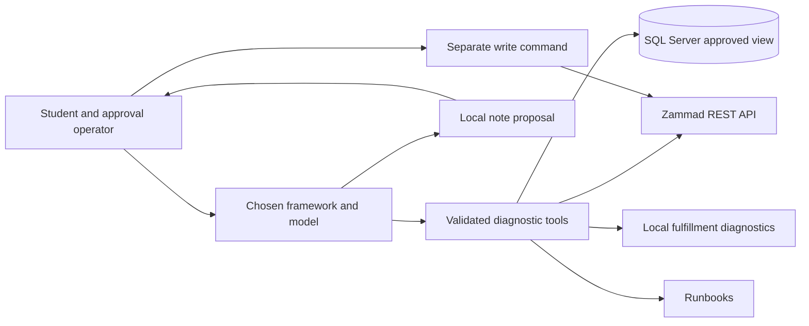

# Building Reliable AI Agents

A self-paced, module-based workshop: learn a concept, build it against a real
local system, inspect the result, and explain the failure cases.

**Start with the [training guide](training-guide.md).** Choose either Python
track: **LangChain / LangGraph / Deep Agents** or **Microsoft Agent Framework**.
Choose either **OpenAI API** or **Anthropic API** independently of that track.
You do not need both providers or both frameworks.

## What you build

Investigate a synthetic customer's report: **"My payment succeeded, but my order
never shipped."** Read a real Zammad ticket, query approved evidence in SQL
Server, inspect fulfillment diagnostics and runbooks, then draft an internal
note. A human reviews the exact note before a separate operator command posts
it to Zammad and verifies it by reading it back.

The required stack is **SQL Server Developer edition, Zammad, and the sample
application**. Qdrant retrieval and Mailpit email are
[optional labs](labs/optional-systems.md). Jira and DeepSeek Harness are excluded.
The framework harnesses do not train model weights.

## Prerequisites and boundaries

- Basic Python and terminal familiarity; no agent or enterprise-system background.
- Python **3.13**, Docker with Linux containers, and Docker Compose v2.
- An Intel/AMD x86-64 Docker host for the SQL Server Linux container. Microsoft
  does not support ARM emulation for that image. ARM learners need an
  instructor-provided supported host; do not assume Apple Silicon compatibility.
- Internet for package/image downloads; a chosen API account only for live-model
  labs. Chat-product subscriptions are not a substitute for API credentials.
- Available loopback ports **8010, 8081, 14330**; optional **6333, 8025, 1025**.
- Zammad's documented container minimum is 4 GB RAM **by itself**, not for this
  complete stack. See [validation](VALIDATION.md) for what was actually exercised
  and resource observations. Do not start every optional service unnecessarily.
- SQL Server's development/test license terms and EULA apply. Zammad is
  AGPL-licensed; open-source obligations still apply when distributing changes.

Only synthetic data belongs here. Local passwords are generated into ignored
`.env`; put API keys there or in the process environment, never in source code.
Live model requests leave the machine and incur provider usage charges. Use
only approved synthetic inputs, watch provider usage, and do not assume that
step/token/time limits create an exact spending cap.

This is not a production deployment template. Loopback bindings, restricted
credentials and containers are useful controls, **not complete security
isolation**. No agent receives a shell, SQL administrator access, or a direct
ticket-writing tool.

## Layout

| Path | Purpose |
| --- | --- |
| [training-guide.md](training-guide.md) | Fourteen progressive modules, practical labs, and capstone |
| [examples](examples) | Shared local service/tools, operator commands, native framework tracks, tests |
| [fixtures](fixtures) | Synthetic runbooks and evaluation cases |
| [infrastructure/compose.yml](infrastructure/compose.yml) | Local systems, isolated database volumes, optional profiles |
| [labs/optional-systems.md](labs/optional-systems.md) | Real Qdrant retrieval and Mailpit email exercises |
| [troubleshooting.md](troubleshooting.md) | Symptoms, diagnosis and safe recovery |
| [VALIDATION.md](VALIDATION.md) | Reproduction commands, observed results and unverified boundaries |

This workshop is independent of Kafka and REST APIs. It does not change or
require their containers, credentials, data, or exercises.
