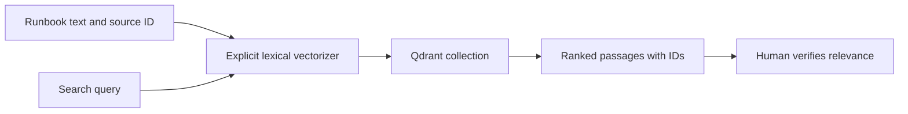
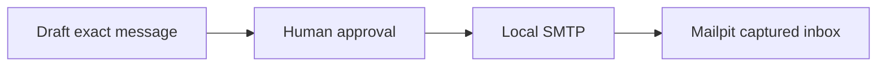

# Optional labs: retrieval and captured email

These are extensions, not prerequisites for the required SQL Server/Zammad
investigation. Run commands from `reliable-ai-agents` using its virtual environment.
Neither exercise needs a paid model or an additional Python package.

## A. Retrieval with a real Qdrant server

**Objective:** Trace document ingestion, representation, search and source
attribution before assuming that vector search produces a trustworthy answer.

Qdrant stores vectors and payloads; it does not invent an embedding model for
you. This lab explicitly uses **signed lexical feature hashing**, a deterministic
64-dimensional representation, so both OpenAI and Anthropic students can run it
without another account. It is not a learned semantic embedding and is not
presented as production-quality semantic search.



**Learner task:** Decide which source fields must survive ingestion. Sketch a
tool result containing passage, source ID and relevance score. Then inspect
`optional.embed`, `optional.ingest` and `optional.search` as the reference.

```powershell
docker compose --env-file .env -f infrastructure\compose.yml --profile retrieval up -d qdrant
Invoke-RestMethod http://127.0.0.1:6333/healthz
.\.venv\Scripts\python.exe examples\optional.py ingest
.\.venv\Scripts\python.exe examples\optional.py search "fulfillment dependency unavailable retry"
```

**Expected:** Three runbooks become real collection points. The returned payloads
contain `RB-...` source IDs and text. Inspect `http://127.0.0.1:6333/dashboard`.
Re-ingestion upserts these three stable IDs; it does not delete the collection.

**Verify:** Inspect a returned passage and judge whether it answers the query.
Try a paraphrase with little word overlap and record the limitation. A large
similarity score is not a probability that the passage is correct.

**Agent integration task:** Add a read-only `search_runbooks(query)` tool calling
the reference search function to your chosen track. Validate input, return only
the two bounded passages and their IDs, and route it through `RunControl`.
Compare the answer and sources with the core `read_runbooks` tool. This wiring is
a learner extension, not enabled by default in either agent.

**Troubleshoot:** Missing collection means ingestion was not completed. A
connection refusal means the optional container is not ready. An irrelevant
match is a retrieval-quality issue, not permission to fabricate an answer.

**Check:** Which component creates vectors? What must change to use a learned
embedding model? Why would changing dimensions/model require a separate
collection or an explicit migration?

**Further exercise:** Select an explicit approved embedding service or local
model and re-embed into a new collection. Document downloads, credentials,
dimensions and costs before use. An Anthropic chat API key does not itself
provide an embedding endpoint. This further exercise is not shipped or validated
as an additional provider integration.

## B. Approval-gated email captured by Mailpit

**Objective:** Exercise a real SMTP submission and verify the resulting message
without contacting a customer.

Mailpit captures mail locally. It is not a production mail provider. This Compose
profile does not configure SMTP relaying or forwarding; do not add them.



**Learner task:** Write a customer-safe update that distinguishes known facts
from hypotheses. Do not copy internal log instructions or claim shipment/refund.
Compare your implementation with `optional.email`.

```powershell
docker compose --env-file .env -f infrastructure\compose.yml --profile email up -d mailpit
.\.venv\Scripts\python.exe examples\optional.py email "We confirmed payment for the synthetic order. Fulfillment needs further investigation; shipment is not confirmed."
```

**Expected:** This command prints a draft and makes **no SMTP request**.
Open `http://127.0.0.1:8025` and establish the initial message count.

```powershell
.\.venv\Scripts\python.exe examples\optional.py email --approve "We confirmed payment for the synthetic order. Fulfillment needs further investigation; shipment is not confirmed."
```

Review the printed message and type the explicit confirmation when requested.
The recipient is fixed to `student@example.invalid`.

**Verify:** Inspect the captured message's subject, body and recipient in the
actual UI. Reject a second proposal and verify the mailbox did not change.
SMTP submission is not proof of delivery to an external inbox; no external
delivery is intended here.

**Troubleshoot:** If the connection drops during submission, inspect Mailpit
before resending. The reference does not automatically retry ambiguous SMTP
submissions. It is an operator driver, not a second durable action ledger.

**Agent integration task:** Have the agent draft the text, but keep this approval
and send command outside its tool set. Do not expose a tool accepting a model's
`approved=true` claim.

**Check:** What changes when the message leaves a test inbox for a real recipient?
Why must "internal note" and "email" be distinct action types?

## Stop optional services

```powershell
docker compose --env-file .env -f infrastructure\compose.yml --profile retrieval --profile email stop qdrant mailpit
```

Do not delete the required workshop volumes merely to reset an optional exercise.
Qdrant and Mailpit are independent services; Zammad's Elasticsearch instance is
for Zammad, not a substitute configured for this retrieval lab.

Official references: [Qdrant local quickstart](https://qdrant.tech/documentation/quickstart/)
and [Mailpit Docker images](https://mailpit.axllent.org/docs/install/docker/).
