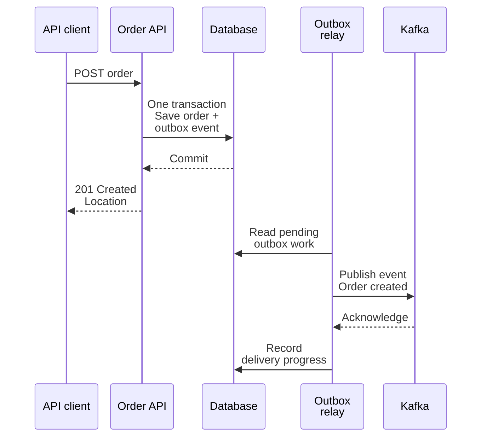

# Enterprise REST API extensions

These are **design exercises**, not implemented production features. Complete the
[core workshop](../training-guide.md) first. Use diagrams and test scenarios;
do not place real credentials or customer data in the repository.

## A. Real identity and resource authorization

**Objective:** Replace a public demo credential with a reviewed trust model.

Sketch client → identity provider → token → API. Distinguish OAuth authorization
from OpenID Connect identity and from an API simply accepting a bearer string.
Compare interactive users, machine-to-machine clients, and browser applications;
they do not all use the same flow or secret-handling model.

Define issuer, audience, signature validation, expiration, approved algorithms,
key rotation, and scopes/roles. A signed JWT must be verified, not merely decoded.
Opaque access tokens require their own approved validation mechanism.

Then specify "read my order" versus "read any order." A token accepted by the API
does not automatically authorize access to every caller-supplied ID.

**Deliverable:** A sequence diagram and tests for missing/expired/wrong-audience
tokens, forbidden actions, and cross-user order access. Decide which failures
return 401, 403, or an intentionally non-revealing 404.

## B. A durable idempotency-key contract

**Objective:** Make a timed-out create operation safe to reconcile or retry.

Design `POST /orders` with an `Idempotency-Key`. Scope keys to the authenticated
caller and operation. Persist a canonical request fingerprint, processing state,
resource/result, and expiration policy.

Define behavior for the same key/body, same key/different body, concurrent requests,
an interrupted request, and expired keys. A key-to-response cache written after
the business transaction can still have a crash window. Explain how your chosen
storage transaction closes or recovers that window.

**Deliverable:** A state diagram, schema, retention policy, and deterministic
concurrency/crash tests. Do not call unique order references alone an
idempotency-key implementation.

## C. API gateway, rate limits, and observability

**Objective:** Allocate responsibilities without creating a false security boundary.

Diagram a TLS endpoint/gateway, identity integration, multiple API instances,
shared database, and telemetry. Define request/body limits, rate-limit identity,
429/Retry-After behavior, upstream timeouts, and who owns error transformations.

Describe how clients back off with jitter and a total budget. Identify why a
replayable GET and an ambiguous order POST need different retry policies.
Do not retry earlier than a server's Retry-After deadline.

**Deliverable:** A gateway/service responsibility table, an overload runbook,
and a trace propagation plan with token/PII redaction and bounded metric labels.
No gateway, limiter, or telemetry backend is installed by the core Compose file.

## D. Contracts and database migrations

**Objective:** Change the API without breaking independently released clients.

Consider adding an optional field, making it required, renaming a field, removing
an enum value, and adding a status unknown to an old client's state machine.
An OpenAPI diff helps, but structural compatibility does not prove semantic safety.

Plan an expand/migrate/contract sequence across application code, database,
documentation, and clients. State a deprecation window and rollback procedure.

**Deliverable:** A client compatibility matrix, migration plan, and contract-test
cases including old requests against new servers and new responses against old clients.

## E. REST plus Kafka without the dual-write trap

**Objective:** Compare synchronous requests with asynchronous events using both
workshops' terminology. Kafka is optional and is not called by this API.

Explain why the 201 confirms order creation, not fulfillment completion. If a
long-running operation is merely accepted rather than completed, design a 202
response with an operation-status resource instead; 202 is not implemented here.

The relay can publish twice if it fails after Kafka acknowledgment but before
recording progress. Consumers still need stable event IDs and deduplication.
Saving a database row then publishing separately without an outbox introduces
a dual-write failure window.

**Deliverable:** Failure scenarios, event identity policy, relay recovery plan,
and a decision on which state the REST GET endpoint reports while downstream
processing is still pending.
