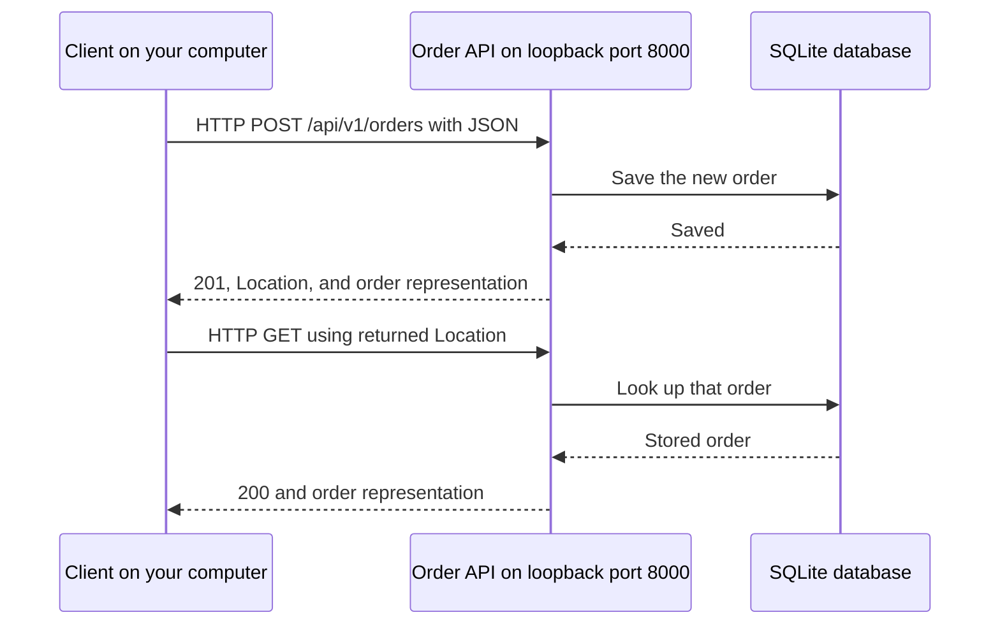

# Module 3: Create an order and read it back

## Purpose and outcomes

A shopping client must know whether an order was accepted and where to find it
later. This module connects a create request to a stored resource and its
returned address.

By the end, you can:

- Create an order and identify its status, representation, and `Location` header.
- Read the resource using the address returned by the server.
- Write a small client that checks outcomes instead of assuming success.
- Demonstrate that a rejected duplicate request leaves an existing order unchanged.

## Starting point

| Requirement | State needed |
| --- | --- |
| Prior learning | Complete [foundations and setup](../../training-guide.md#environment-preparation), then [module 2](../../training-guide.md#2-start-the-server-and-inspect-the-contract-30-minutes) |
| Working directory | Repository root, containing `rest-apis` and `.venv`; do not change into this module's directory |
| Server | Use the native Python or Docker server from module 2, listening at `http://127.0.0.1:8000` |
| Python environment | The repository `.venv` has the [REST dependencies](../../examples/requirements.txt) installed |
| Credentials | Use the workshop's public demonstration Bearer token, `workshop-demo-token` |
| Existing data | Orders may already exist; record your own returned ID rather than relying on collection totals |

Use the browser to open `http://127.0.0.1:8000/health`. Expect
`{"status":"ok"}`. This checks availability; the lab will verify the business operation.

Set the Python variable in your current client terminal:

**Windows PowerShell**

```powershell
$Python = ".\.venv\Scripts\python.exe"
& $Python rest-apis\examples\client.py health
```

**macOS/Linux Bash or zsh**

```bash
Python=".venv/bin/python"
"$Python" rest-apis/examples/client.py health
```

The same Python exercise runs on both paths. The actual host execution recorded
for this pilot is identified in [VALIDATION.md](../../VALIDATION.md#module-3-format-pilot).

## Concept introduction

A **collection** is a group of resources: `/api/v1/orders`. A **resource** is one
order: `/api/v1/orders/{id}`. The braces describe a variable portion of the path,
not characters sent in the final URL.

`POST` submits the new order to the collection. Our API creates its own ID and
returns **201 Created**. The response body contains the order's JSON representation,
and the **Location** header tells the client where to read it.



The arrows show requests and responses, not background event delivery.
The first request changes stored data; the second reads it.

Two identifiers serve different purposes:

| Field | Role |
| --- | --- |
| `reference` | A unique business reference supplied by the client, such as `exercise-<random suffix>` |
| `id` | A UUID generated by the server and used in the resource path |

The create input is `reference`, `item`, and `quantity`. The server also returns
`status` (initially `pending`), `created_at`, and `version`. JSON is the data
format; HTTP status and headers still carry essential outcome information.

Before running the lab, predict: does `201` mean a new order was stored or that
the order has shipped? What would you expect a subsequent GET to return?

## Guided lab

### Step 1: Create an order

Use the supplied CLI to observe a completed interaction before writing your own.
Omitting `--reference` generates a new business reference on each invocation.

**Windows PowerShell**

```powershell
& $Python rest-apis\examples\client.py create --item "Training notebook" --quantity 2
```

**macOS/Linux Bash or zsh**

```bash
"$Python" rest-apis/examples/client.py create --item "Training notebook" --quantity 2
```

**Expected observation:** `HTTP 201`, followed by headers and a JSON object.
Record the actual `id`, `reference`, and `location` returned. The Location ends
with the same ID as the body. `quantity` is 2 and `status` is `pending`.

The response also includes `ETag` (a representation validator) and `X-Request-ID`
(an identifier for this request). You will use those headers in later modules;
you do not need to manufacture either value here.

### Step 2: Read your resource

Replace `YOUR_RETURNED_UUID` with the actual ID from step 1 before running:

**Windows PowerShell**

```powershell
$OrderId = "YOUR_RETURNED_UUID"
& $Python rest-apis\examples\client.py get $OrderId
& $Python rest-apis\examples\client.py list
```

**macOS/Linux Bash or zsh**

```bash
OrderId="YOUR_RETURNED_UUID"
"$Python" rest-apis/examples/client.py get "$OrderId"
"$Python" rest-apis/examples/client.py list
```

**Expected observation:** GET returns `200` and the same stored fields as the
create response. The list returns `200` and a collection envelope with `items`,
`total`, `limit`, `offset`, and `next`.

Your order may be on a later page if earlier exercises already created records.
Use its direct resource address as the verification; collection totals and first
page membership are not the passing criterion for this module.

### Step 3: Read using Location rather than constructing an address

The CLI's `get` command constructs the known resource path from an ID. A client
can instead follow the server's returned Location. Find `location:` in your
step 1 output and compare its final path segment with the recorded ID.
A relative Location such as `/api/v1/orders/<id>` is resolved against the
same API base URL.

In the next exercise you will capture `response.headers["Location"]` and pass
it to HTTPX using a configured base URL. This avoids guessing how the server
chooses IDs.

**Expected observation:** A create response supplies everything needed to locate
the new resource without searching the entire collection.

## Independent exercise

Complete [the starter](../../exercises/03-create-and-read.py) by implementing its
`run(client, reference)` function. The shell, argument parsing, timeout, token,
and final output are provided; your function implements the HTTP interactions.
Keep the completed solution closed until you have made an attempt.

Your function must:

1. POST an order with the supplied reference, item `"Exercise notebook"`, and
   quantity 3. Check for 201 before interpreting it as success.
2. Capture the returned Location and GET that address. Check for 200 and compare
   the complete create/read representations.
3. Repeat the same POST and verify the duplicate-reference behavior in the next section.
4. GET the original order again and prove the rejected write left it unchanged.
5. Return a dictionary containing `id`, `reference`, `location`,
   `create_status`, `read_status`, `duplicate_status`, and
   `unchanged_after_rejection`. A failed check must raise an error, not return
   a passing result.

Use `httpx.Client.post(..., json=...)`, `.get(...)`, `.status_code`,
`.headers`, and `.json()`. Reuse the supplied client rather than creating a
new network connection for every call. Do not retry POST automatically: a lost
response can leave its outcome uncertain.

Launch your work from the repository root:

**Windows PowerShell**

```powershell
& $Python rest-apis\exercises\03-create-and-read.py
```

**macOS/Linux Bash or zsh**

```bash
"$Python" rest-apis/exercises/03-create-and-read.py
```

The unmodified starter deliberately raises `NotImplementedError`. On each run,
its wrapper generates a new reference. It prints results and an exercise order
only after your function returns; you must implement the assertions yourself.

## Failure or variation

The exercise tests a duplicate create request:

| Request | Expected response | Expected stored state |
| --- | --- | --- |
| Same reference and body submitted again | 409 Conflict: the reference already exists | Original order unchanged |

Inspect the error representation. It contains `status` and `detail` and uses
the `application/problem+json` media type. A deliberate 409 is evidence
of an exercised contract, not a reason to keep retrying.

Reusing a reference is not a cache of the original response: the server returns
409 rather than replaying the original 201. Module 10 explores ambiguous outcomes
and retry decisions more deeply.

As an additional variation, run the supplied CLI's `get` command twice for your
guided-lab order. Both should read the same business data without creating orders.

## Verification and evidence

| Claim | Evidence to collect | Passing result |
| --- | --- | --- |
| A resource was created | Create status, ID, reference, and Location | 201; Location identifies the returned ID |
| The returned address works | GET using captured Location | 200; complete representation matches the create response |
| Duplicate input is explicit | Second POST status and error detail | 409; no overwritten fields |
| The failed write did not change the order | Final GET compared with the first representation | All original fields, including version, unchanged |
| You can interpret the result | A short explanation of ID versus reference and 201 versus 200 | Explain creation and retrieval without conflating them with shipment |

Save a short request/result table in your own notes. Record error details as
well as numeric codes. A printed JSON object alone is not proof of correct checks.

## Troubleshooting

| Symptom | Check and recovery |
| --- | --- |
| Connection refused or timed out | Confirm the module 2 server is running; inspect `/health` and the base URL |
| 401 | Use the public demo token; Swagger Authorize takes the token without the word Bearer |
| CLI rejects the ID before HTTP | Replace the placeholder with your actual UUID; keep it separate from the business reference |
| 409 on the first exercise POST | Use a fresh reference; the wrapper does this automatically unless you pass `--reference` |
| Your order is absent from the first collection page | Read it directly by Location/ID or follow pagination |
| Starter exits with NotImplementedError | Implement `run`; this deliberate marker is the learner task |
| A duplicate POST appears successful in your reported output | Inspect actual status before returning; do not hardcode expected results |

See [workshop troubleshooting](../../troubleshooting.md) for environment diagnosis.

## Reset and handoff

Keep the server running and retain the guided-lab order and your `$OrderId`
(PowerShell) or `OrderId` (Bash/zsh). Module 4 uses the same server and Python
environment. Module 5 later updates this order.

Keep the exercise's separate reference/ID in your notes. Rerunning the wrapper
creates another reference; it does not overwrite your previous order. Deletion
and version-precondition handling are taught in module 9, so do not wipe the
database to reset this exercise.

If reopening a terminal, recreate `$Python`/`Python` and the recorded order ID.
Continue to [module 4: a real client](../../training-guide.md#4-build-and-understand-a-real-client-45-minutes).
This is the first module-format pilot; other modules retain their existing layout.

## Knowledge check

1. Why should a client check for 201 before treating a create response as success?
2. What is the difference between the order's `reference` and its `id`?
3. Why follow Location rather than predict the next ID?
4. Why can a repeated POST return a different status than the first POST?
5. What proves the rejected request left the original resource unchanged?

## Reference implementation

After attempting the exercise, compare with
[the completed client](../../solutions/03-create-and-read.py). Launch it with
the same shell command as the starter, replacing `exercises` with `solutions`.
It creates its own exercise order; it does not complete or alter your starter.

Compare how it validates each HTTP outcome and the final stored representation.
Both programs accept `--base-url`, `--token`, and `--reference`; the defaults
target the local workshop. If an initial POST times out, reconcile its reference
before resubmitting instead of assuming it did nothing.
