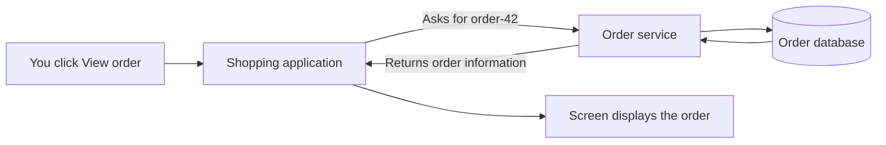
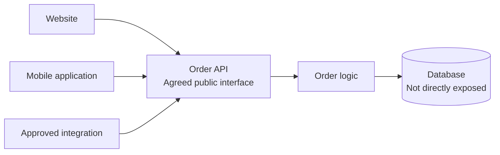
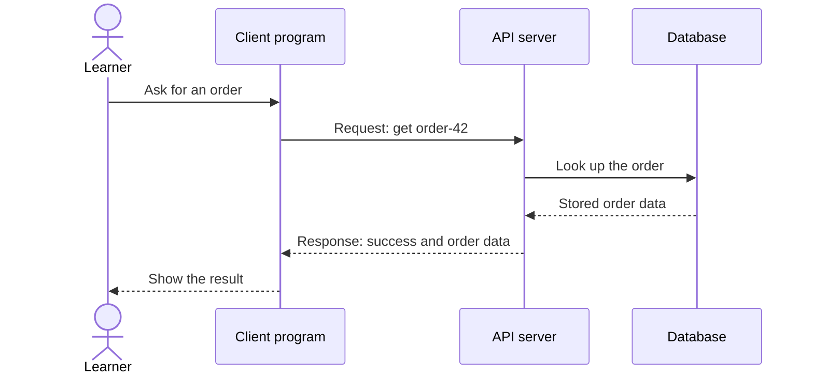
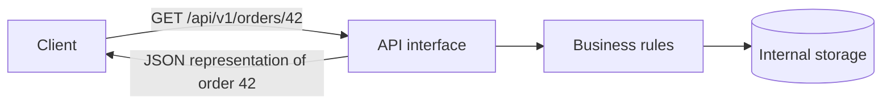
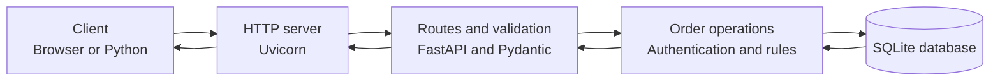
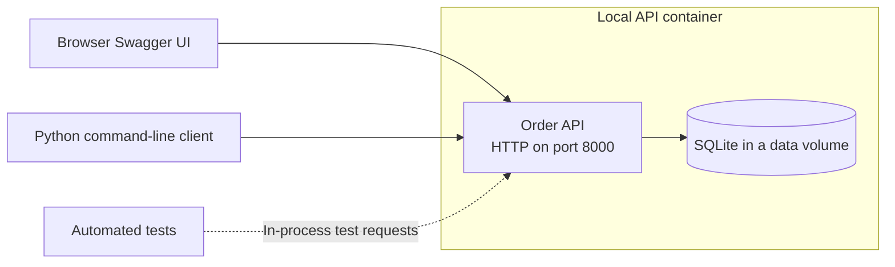
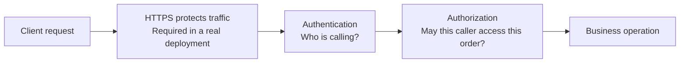
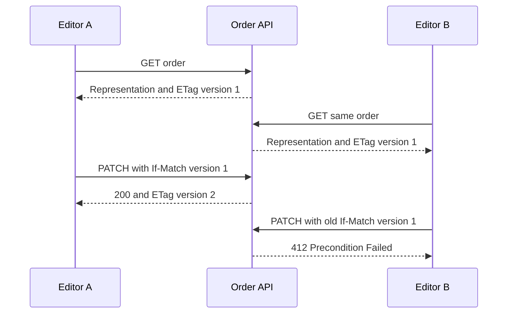
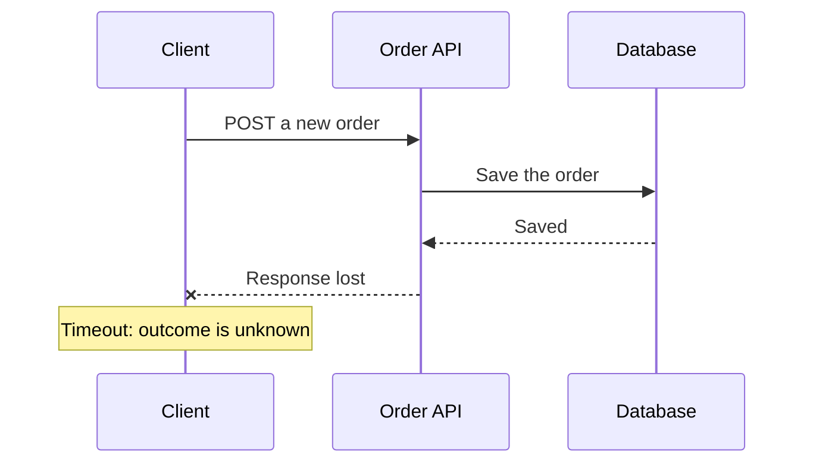
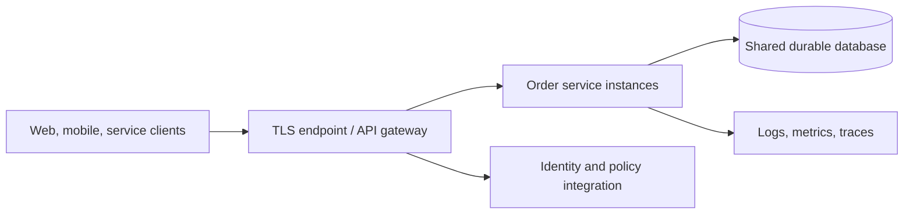

# REST APIs hands-on workshop

## How to use this guide

Start with the diagrams in module 1, not the terminal. We assume basic programming
knowledge but no knowledge of web applications, APIs, HTTP, or enterprise systems.
You will gradually build a client and a server that manage synthetic orders.

The learning cycle is **understand → predict → try → inspect → explain**. For each
lab, record the request, response status, important headers, and what changed.
An HTTP request completing is not automatically a successful business operation.

### Outcomes and schedule

| Session | Modules | Outcome |
| --- | --- | --- |
| Day 1 morning | 1 and setup | Build a mental model of clients, servers, HTTP, and REST |
| Day 1 afternoon | 2-4 | Run an API, use its documentation, and write client calls |
| Day 2 morning | 5-7 | Design resources, validate requests, and understand authentication |
| Day 2 afternoon | 8-9 | Read collections and prevent conflicting updates |
| Day 3 morning | 10-11 | Handle failures and observe requests through the architecture |
| Day 3 afternoon | 12 and capstone | Explain enterprise responsibilities and demonstrate the solution |

Experienced developers can use a two-day format with foundations prereading.
The [optional extensions](labs/enterprise-extensions.md) are separate design
exercises, not prerequisites for the core workshop.

## 1. Understanding APIs: from two programs to a web service (90-120 minutes)

**Objective:** Explain what an API is, follow a request and response, and distinguish
HTTP mechanics from REST design before running any software.

### 1.1 Start with a familiar action

You click "View order" in a shopping application. The screen does not necessarily
store the order itself: it asks another program for the information.

An **application** is a program doing useful work. A **database** stores and
queries information. A **service** provides a capability to other programs, such
as finding orders or accepting a new one.



We separate the screen from the service so a website, a mobile application, and
other approved systems can use the same order capability. They do not need
direct access to the database.

**Check:** Which component displays information? Which component decides how
orders are stored? Why should a mobile application not contain a database password?

### 1.2 What is an API?

**API** means **Application Programming Interface**: an agreed way for one program
to use another program's capabilities. An API defines what you can ask for, how
to ask, and what result or error you can expect.

Even a library function has an API: `len(items)` has an accepted input and a
defined result. A **web API** exposes capabilities over a network.

Imagine a service counter with an order form. The form tells you which details
are required and which requests are supported. You do not walk into the warehouse
and edit its shelves yourself. The analogy explains the boundary, but real APIs
also need precise data formats, authentication, failure handling, and versioning.



The API is the interface, not the entire database and not necessarily a separate
program. Our API will be implemented inside the order service.

**Check:** If the service changes its database tables, must every client change?
Not if the external API contract and its behavior remain compatible.

### 1.3 Client, server, request, response

The program asking is the **client**. The program listening and answering is the
**server**. These describe roles in an interaction, not necessarily different
kinds of machines. A service can be a server for one call and a client for another.



A **request** is one attempt to ask for information or an action. A **response**
is the server's reply. In a normal synchronous call, the client waits for the
response, but it must stop waiting after a sensible timeout.

If the reply is lost, the client may not know whether the server finished the
work. "I did not receive success" is not equivalent to "nothing happened."

**Check:** Can a Python script be a client? Can a server call another server?
What does a timeout actually prove?

### 1.4 HTTP: the language of the conversation

**HTTP** is a protocol: shared rules for exchanging requests and responses.
**HTTPS** uses HTTP over an encrypted, authenticated TLS connection.
REST APIs commonly use HTTP, but not every HTTP API follows REST.

An **endpoint** is an exposed operation identified in practice by a method and
address. A **URL** tells the client where to connect and which resource it wants:

```text
http://127.0.0.1:8000/api/v1/orders?limit=2
|       |         |   |              |
scheme  host      port path          query parameters
```

`127.0.0.1` means this computer. The **port** distinguishes listening services;
8000 is our workshop choice, not a required REST port. A **path** identifies a
resource or collection; query parameters modify a query, such as its page size.

The examples below show an illustrative HTTP/1.1 message. Libraries manage the
actual connection, body length, and wire formatting for us.

```http
GET /api/v1/orders?limit=2 HTTP/1.1
Host: 127.0.0.1:8000
Accept: application/json
Authorization: Bearer workshop-demo-token
```

```http
HTTP/1.1 200 OK
Content-Type: application/json
X-Request-ID: example-request-id

{"items": [], "total": 0, "limit": 2, "offset": 0, "next": null}
```

| Part | Meaning |
| --- | --- |
| Method | Intended operation, such as GET or POST |
| Headers | Metadata: accepted format, credentials, caching, and more |
| Request body | Optional content sent to the server, such as a new order |
| Status code | Standard indication of the response outcome |
| Response body | Returned representation or structured error, when applicable |

**JSON** is a text data format with objects, arrays, strings, numbers, booleans,
and null. It is not a programming language or a synonym for REST.
`Content-Type` describes the body actually sent; `Accept` describes response
formats the client prefers. Our service returns JSON and is not a complete
multi-format content-negotiation implementation.

**Check:** Where would a new order's quantity go? Is an HTTP 404 the same as a
network connection failure?

### 1.5 What does REST mean?

**REST**, Representational State Transfer, is an architectural style for
distributed systems. A central idea is interacting with **resources** through
a uniform interface rather than inventing unrelated commands for every action.

A resource is something the API exposes, such as an order or the order collection.
A **representation** is data describing that resource, such as a JSON order.
The representation is not the resource's internal database row or table schema.



The short ID `42` is just conceptual here; our runnable service uses UUIDs.
REST's constraints include client/server separation, stateless interactions,
cacheability, a uniform interface, and layered systems; code-on-demand is optional.
**Stateless** means each request includes the context needed to interpret it,
not that the server cannot store orders in a database.

Strict REST also includes following links and controls in representations, often
called hypermedia. This workshop implements a pragmatic resource-oriented HTTP
API with collection navigation, not a complete hypermedia-driven REST system.
Calling every JSON endpoint "REST" hides useful design distinctions.

**Check:** Does storing orders violate statelessness? Must REST use JSON?
Does returning JSON by itself prove an API follows REST?

### 1.6 Resources and methods

Use nouns for resource paths and HTTP methods for their intended operations.
The same collection can support different methods:

| Request | Our workshop meaning | Typical success |
| --- | --- | --- |
| `GET /api/v1/orders` | Read a page of orders | 200 |
| `POST /api/v1/orders` | Create an order with a server-generated ID | 201 |
| `GET /api/v1/orders/{id}` | Read one order | 200 |
| `PUT /api/v1/orders/{id}` | Replace all client-editable fields on an existing order | 200 |
| `PATCH /api/v1/orders/{id}` | Change supplied editable fields | 200 |
| `DELETE /api/v1/orders/{id}` | Delete an existing order | 204 |

HTTP permits other valid API designs. For example, PUT can create a resource
at a client-chosen URL if the API contract supports it; our service does not.

A **safe** method should not request a business-state change: GET is safe.
An **idempotent** operation has the same intended effect when repeated as when
performed once. PUT and DELETE have idempotent semantics; their repeated responses
need not be identical. A second DELETE can return 404 because the resource is gone.
POST is not generally idempotent. PATCH may or may not be, depending on its operation.

**Check:** Why is `GET /deleteOrder?id=42` a dangerous design? Is incrementing
a quantity by one the same kind of PATCH as setting it to three?

### 1.7 What is the server built from?

We will build a small but recognizable service:



**Uvicorn** listens for network requests and runs our Python web application.
**FastAPI** maps method/path combinations to Python functions and describes the
API. **Pydantic** validates the shape and types of submitted data. **SQLite**
stores records in a file. You do not need to memorize these names before the lab.

An **API contract** specifies accepted input, responses, errors, and behavior.
**OpenAPI** is a machine-readable format for describing much of that contract.
**Swagger UI** is an interactive page that reads the description and makes
requests; it is a client, not the database or the service implementation.

In the workshop, routing, validation, and order functions share one small file
so learners can follow a request. Separate boxes represent responsibilities,
not a requirement to deploy five separate containers.

**Check:** If OpenAPI documents a response, does that guarantee the implementation
always behaves correctly? Why are behavioral tests still necessary?

### 1.8 Why APIs, and when is REST a good fit?

APIs let several clients reuse controlled capabilities, hide internal storage
details, integrate different languages, and evolve systems behind stable contracts.
HTTP brings widely available tooling, status semantics, caching mechanisms,
intermediaries, and observability conventions.

These benefits require deliberate design, not just installing a web framework.

| Need | Starting point |
| --- | --- |
| Read or update business resources with a direct response | A resource-oriented HTTP API can be a good fit |
| Immediate answer about current order state | A synchronous API backed by the authoritative application |
| Durable event history and independent replaying subscribers | An event platform such as Kafka; REST alone does not provide this |
| Bidirectional, continuous low-latency interaction | Consider WebSockets or a suitable streaming protocol |
| Strongly typed service calls with streaming needs | Compare RPC approaches such as gRPC |
| Two functions inside one small program | A normal function/library API may be simpler |

REST is not a message queue, not a guarantee of transactionality across services,
and not a requirement to split every application into microservices.
Network boundaries add latency, partial failures, authentication, and operating cost.

General guidance: design meaningful resources, use HTTP semantics consistently,
keep GET free of business mutations, validate input, bound collection sizes, use
timeouts, and protect confidential traffic with HTTPS. Decide how changes affect
existing clients before publishing the contract.

**Check:** Would reading an order's current status and broadcasting every order
change to ten independent systems necessarily use the same integration mechanism?

### 1.9 Our solution and its boundaries

Our clients will create, read, update, and delete synthetic orders. The server
will enforce a contract, save data, and return explainable HTTP responses:



The Python client and browser use the real network listener. In-process tests
isolate application behavior; later checks also exercise the live container.
A **container** packages an application with its runtime. It is not an API and
does not make the application scalable or secure automatically.

Our public demo token teaches where credentials go, not how to implement identity.
Orders have no real customer data, payments, shipping integration, or Kafka dependency.
Business-status transitions are intentionally permissive; a real service needs
explicit rules, authorization, auditing, and ownership checks.

**Foundation exercise:** Draw one create request and one read request. Label the
client, server, method, URL, headers, body, database operation, and response.

**Verify before starting:** Explain the difference between HTTP and REST, between
an API and a database, and between "server returned an error" and "no response
arrived." Revisit the diagrams if those distinctions are unclear.

## Environment preparation

Read the [prerequisites and safety boundaries](README.md). Run every command from
the **repository root**, using synthetic data only. Keep the existing Kafka
workshop environment if already installed; these commands add REST dependencies.

PowerShell:

```powershell
python --version
docker version
docker compose version
```

If `.venv` does not already exist:

```powershell
python -m venv .venv
```

Then:

```powershell
.\.venv\Scripts\python.exe -m pip install -r rest-apis\examples\requirements.txt
$Python = ".\.venv\Scripts\python.exe"
$Compose = "rest-apis\infrastructure\compose.yml"
$Base = "http://127.0.0.1:8000"
$Headers = @{ Authorization = "Bearer workshop-demo-token" }
```

Set these variables in every new terminal where you need them. Using the Python
executable directly avoids virtual-environment activation or execution-policy changes.

macOS/Linux:

```bash
# Create this environment only if it does not already exist.
python3 -m venv .venv
.venv/bin/python -m pip install -r rest-apis/examples/requirements.txt
Python=".venv/bin/python"
Compose="rest-apis/infrastructure/compose.yml"
Base="http://127.0.0.1:8000"
```

For the Python and Docker commands below, change `& $Python` to `"$Python"`, quote
`"$Compose"` as appropriate, and use `/` in local paths. PowerShell's
`Invoke-WebRequest` and `Invoke-RestMethod` examples are host-specific: use the
Python client or Swagger UI on other hosts. Module 4 also includes portable curl
examples. On Windows, use `curl.exe` explicitly to avoid older PowerShell aliases.

## 2. Start the server and inspect the contract (30 minutes)

**Objective:** Distinguish a running server, a health response, and API documentation.

```powershell
docker compose -f $Compose config --quiet
docker compose -f $Compose up -d --build --wait --wait-timeout 120
docker compose -f $Compose ps
& $Python rest-apis\examples\client.py health
```

**Expected:** A healthy container and `HTTP 200` with `{"status": "ok"}`.
The health endpoint checks that the orders table can be read; it is not proof
that every feature or business workflow works.

Open these addresses in a browser:

| Address | Purpose |
| --- | --- |
| `http://127.0.0.1:8000/docs` | Swagger UI: interactive client |
| `http://127.0.0.1:8000/openapi.json` | Machine-readable API description |
| `http://127.0.0.1:8000/health` | Public health response |

In Swagger UI select **Authorize**, enter `workshop-demo-token` without adding the
word `Bearer`, and authorize. The UI supplies the header. Expand
`GET /api/v1/orders`, select **Try it out**, then **Execute**.

**Verify:** Inspect the generated request and the empty collection response.
Find the create request schema and its required fields. The full response has
pagination metadata even when `items` is empty.

If image download or package installation fails, use
[build troubleshooting](troubleshooting.md#container-build-or-installation-fails);
do not disable TLS verification.

**Without Docker:** In a dedicated terminal at the repository root, run:

```powershell
& $Python -m uvicorn api:app --app-dir rest-apis\examples --host 127.0.0.1 --port 8000 --no-access-log
```

This uses `.state/rest-api.db` on the host instead of the Docker volume. Do not run
both listeners on port 8000. Stop the foreground server with Ctrl+C.

**Check:** Why is the `/docs` page a client even though the same server hosts it?

## 3. Your first create and read requests

Continue in [module 3: Create an order and read it back](modules/03-create-and-read/README.md).
This canonical module pilots the shared training format: conceptual introduction,
guided lab, independent client exercise, failure checks, evidence, and handoff.

Complete its guided lab and retain the returned order ID as `$OrderId` in
PowerShell or `OrderId` in Bash/zsh before continuing below. Each exercise run
uses a separate business reference, so this module works with existing orders.

## 4. Build and understand a real client (45 minutes)

**Objective:** Make a request from code and inspect both success and failure.

Read `rest-apis/examples/client.py`. Locate the base URL, Authorization header,
timeouts, JSON serialization, bounded retry loop, and nonzero error exit code.
The full CLI is a reusable client; this minimal inline example shows the essentials:

```powershell
@'
import httpx

with httpx.Client(base_url="http://127.0.0.1:8000", timeout=5.0) as client:
    response = client.get(
        "/api/v1/orders",
        headers={"Authorization": "Bearer workshop-demo-token"},
    )
    print(response.status_code, response.headers.get("content-type"))
    response.raise_for_status()
    print(response.json())
'@ | & $Python -
```

On macOS/Linux, put the Python lines in an interpreter or use your shell's heredoc
syntax. `response.json()` decodes JSON; it does not prove the HTTP request succeeded.
`raise_for_status()` is one way to make non-success responses explicit.

Use a second client tool:

```powershell
curl.exe -i -H "Authorization: Bearer workshop-demo-token" "http://127.0.0.1:8000/api/v1/orders?limit=2"
```

On macOS/Linux use `curl` rather than `curl.exe`. `-i` includes response headers.
Unlike our Python CLI, curl does not treat HTTP error statuses as command failures
by default; `--fail-with-body` can do that where the installed version supports it.

Now deliberately use incorrect credentials:

```powershell
& $Python rest-apis\examples\client.py --token wrong-token list
```

**Expected:** `401`, a structured error, and a nonzero process exit code. This is
an intentional failure, not a broken setup.

**Verify:** Compare the same list request from Swagger UI, curl, and Python.
They use the same contract even though the clients are different programs.

**Check:** Why should a client set a timeout instead of waiting indefinitely?

## 5. Design resources and implement CRUD (50 minutes)

**Objective:** Connect HTTP operations to service code without exposing storage internals.

CRUD means create, read, update, delete. Read `api.py` and trace a POST from its
route through validation, authentication, insertion, and response headers.
Parameterized SQL keeps values separate from SQL code.

The collection path is `/api/v1/orders`, not `/createOrder`. The version prefix
is an explicit workshop convention, not a REST requirement.

Our replacement operation requires **all editable fields**: `item`, `quantity`,
and `status`. `reference`, ID, and creation time are immutable in this contract.
PATCH accepts a nonempty object containing selected editable fields, not JSON
Patch operations or JSON Merge Patch. It uses `application/json`, and explicit
null is rejected.

First retrieve the current ETag and keep its quote characters:

```powershell
$Read = Invoke-WebRequest -Uri "$Base/api/v1/orders/$OrderId" -Headers $Headers
$EditHeaders = @{
    Authorization = "Bearer workshop-demo-token"
    "If-Match" = [string]$Read.Headers["ETag"]
}
$Patch = Invoke-WebRequest -Uri "$Base/api/v1/orders/$OrderId" -Method Patch -Headers $EditHeaders -ContentType "application/json" -Body '{"quantity":3}'
$Patch.Content
```

Then replace all editable fields using the newly returned ETag:

```powershell
$EditHeaders["If-Match"] = [string]$Patch.Headers["ETag"]
$Replaced = Invoke-WebRequest -Uri "$Base/api/v1/orders/$OrderId" -Method Put -Headers $EditHeaders -ContentType "application/json" -Body '{"item":"Training notebook","quantity":4,"status":"confirmed"}'
$Replaced.Content
```

**Expected:** Both responses are `200`; PATCH preserves unspecified fields.
PUT requires the complete editable representation. Each actual change advances
the version. The next module intentionally tests incomplete/invalid bodies.

Module 9 explains why we used `If-Match`. On macOS/Linux use Swagger UI to supply
the ETag header or copy it into the Python client's `--etag` argument. Quoting
header values through shells can differ, so the PowerShell header dictionary is
the primary Windows example.

**Verify:** Read the order and explain which fields each update changed.
Do not delete this order yet; module 9 uses it for the concurrent-edit exercise.

**Check:** Why should the API be able to change its internal table layout without
changing every consumer of its JSON representation?

## 6. Status codes, validation, and errors (45 minutes)

**Objective:** Treat errors as part of the contract, not as unexpected text to ignore.

| Code | Meaning in this workshop |
| --- | --- |
| 200 | Successful read/update with a response representation |
| 201 | New resource created; inspect `Location` |
| 204 | Successful deletion; no response body |
| 304 | Conditional read found no change; use your cached representation |
| 401 | Missing or invalid demo credentials |
| 404 | Resource or route not found |
| 405 | Method is not supported on that route |
| 409 | Duplicate business reference conflicts with existing data |
| 412 | Your update precondition does not match the current version |
| 422 | Input does not match this API's validation contract |
| 428 | Required `If-Match` precondition was omitted |
| 503 | A database operational error prevented completion |

Other real services use 400 for malformed/invalid requests and 403 for denied
permissions. This implementation uses FastAPI's 422 convention for body/query/path
validation and has no separate user permissions, so it does not demonstrate a
real authorization-denied 403.

Deliberately fail quantity validation:

```powershell
& $Python rest-apis\examples\client.py create --quantity 0
& $Python rest-apis\examples\client.py list --limit 51
```

In Swagger UI, try a create body with an unknown field, a string quantity instead
of an integer, and a whitespace-only item. All should be rejected without adding
orders. Try repeating the actual reference from your module 3 order to observe a 409.

Errors use a Problem Details shape and `application/problem+json`:

```json
{
  "type": "about:blank",
  "title": "Not Found",
  "status": 404,
  "detail": "Order not found.",
  "instance": "/api/v1/orders/example",
  "request_id": "server-generated-correlation-id"
}
```

The path above is illustrative; use a valid but nonexistent UUID to produce an
actual resource 404. A malformed UUID instead produces 422.
Validation errors also include an `errors` array. The server avoids echoing raw
request bodies or database error details into those responses.

**Verify:** Inspect status, media type, detail, and request ID on a failure.
Confirm the rejected request did not mutate stored data.

**Check:** Should a client automatically repeat a validation failure? Why is
returning `200` with `{"error":"failed"}` misleading?

## 7. Authentication, authorization, and browser boundaries (40 minutes)

**Objective:** Separate identity, permissions, transport protection, and browser policy.

**Authentication** establishes who or what is calling. **Authorization** decides
what that caller is allowed to do. Our single shared token demonstrates credential
transport only: every accepted caller has the same access.



The production-oriented boxes are conceptual. Our local listener is HTTP, and
our API does **not** implement per-user or per-order permissions.

Compare these calls:

```powershell
curl.exe -i "http://127.0.0.1:8000/api/v1/orders"
curl.exe -i -H "Authorization: Bearer wrong" "http://127.0.0.1:8000/api/v1/orders"
curl.exe -i -H "Authorization: Bearer workshop-demo-token" "http://127.0.0.1:8000/api/v1/orders"
```

**Expected:** 401, 401, and 200. Bearer means possession of the token grants the
associated access. Never put real tokens into URLs, source files, screenshots,
or shared shell history. This workshop string is explicitly public.

**CORS**, Cross-Origin Resource Sharing, is a browser mechanism controlling whether
browser scripts can read certain cross-origin responses. It is not authentication
and does not stop Python or curl callers. A browser page's origin includes its
scheme, host, and port. Our docs and API share an origin, so the core lab needs
no CORS configuration.

**Verify:** Explain why a request might work from Python but be blocked from a
separately hosted browser frontend. Do not "fix" that by indiscriminately allowing
all origins or disabling identity checks.

**Check:** Would hiding the Swagger page secure the API? Why must a real order
service check access to the requested order, not merely accept any valid login?

## 8. Collections, filtering, and pagination (40 minutes)

**Objective:** Read bounded collections and follow navigation without downloading everything.

Create several orders with automatically generated references:

```powershell
& $Python rest-apis\examples\client.py create --item "Blue notebook"
& $Python rest-apis\examples\client.py create --item "Green notebook"
& $Python rest-apis\examples\client.py create --item "Black notebook"
& $Python rest-apis\examples\client.py list --limit 2
& $Python rest-apis\examples\client.py list --limit 2 --offset 2
& $Python rest-apis\examples\client.py list --status confirmed --limit 2
```

Collections return exactly these top-level fields:

```json
{
  "items": [],
  "total": 0,
  "limit": 2,
  "offset": 0,
  "next": null
}
```

`total` counts matching records, not just this page. `next` is a relative link or
null when no next page is available. Actual results depend on your earlier labs.
An empty collection is `200` with an empty array, not a missing-resource 404.

Read and follow the first next-page link:

```powershell
$Page = Invoke-RestMethod -Uri "$Base/api/v1/orders?limit=2" -Headers $Headers
$Page
if ($Page.next) {
    Invoke-RestMethod -Uri "$Base$($Page.next)" -Headers $Headers
}
```

The server applies a stable ordering by creation time and ID and caps a page at
50 items. Offset pagination is easy to understand, but concurrent insertions or
deletions can shift page boundaries. It does not promise a snapshot across calls;
even the page's count and items may reflect nearby changes. Large changing
collections often need cursor-based pagination.

**Verify:** Follow `next` until null. Explain why a filter must remain part of
subsequent page requests and why clients should not assume the default page
contains every order.

**Check:** Why might `GET /orders` returning millions of records be an availability
problem even if the caller is authenticated?

## 9. Caching and safe concurrent updates (60 minutes)

**Objective:** Use ETags for revalidation and to prevent a lost update.

An **ETag** is an opaque representation validator returned in a response header.
Clients should copy it, including its quotes, not manufacture it from JSON.
Our ETag changes when editable order data changes.

Read the order and ask whether it changed:

```powershell
$Read = Invoke-WebRequest -Uri "$Base/api/v1/orders/$OrderId" -Headers $Headers
$Tag = [string]$Read.Headers["ETag"]
& $Python rest-apis\examples\client.py get $OrderId --if-none-match $Tag
```

**Expected:** `304` with no body. A client with a cached representation can reuse
that body. The demonstration CLI displays the response but does **not** implement
a persistent cache. If shell quoting alters the ETag, enter it in Swagger UI's
`if-none-match` field instead.

Single-order reads return `Cache-Control: private, max-age=0, must-revalidate`:
private clients may retain data but must revalidate before reuse. Other responses
default to `no-store`. Shared caches must not serve one caller's private data
to another. Caching policy is a deliberate API/security choice.

Now model two people editing the same version:



Use the same saved version twice:

```powershell
$Stale = Invoke-WebRequest -Uri "$Base/api/v1/orders/$OrderId" -Headers $Headers
$StaleHeaders = @{
    Authorization = "Bearer workshop-demo-token"
    "If-Match" = [string]$Stale.Headers["ETag"]
}
Invoke-RestMethod -Uri "$Base/api/v1/orders/$OrderId" -Method Patch -Headers $StaleHeaders -ContentType "application/json" -Body '{"quantity":7}'
Invoke-RestMethod -Uri "$Base/api/v1/orders/$OrderId" -Method Patch -Headers $StaleHeaders -ContentType "application/json" -Body '{"quantity":8}'
```

**Expected:** The first succeeds and the second returns 412; PowerShell reports
an HTTP error for that intentional failure. If the quantity was already seven,
the first update was a no-op and did not advance the ETag: choose different values.
Re-read and reconcile rather than blindly overwriting another caller's change.
Omitting `If-Match` yields 428. `If-Match: *` checks existence but does not detect
which version changed; do not use it to bypass the lost-update exercise.

The implementation holds a SQLite write transaction across comparison and update.
Comparing a version then updating later without an atomic guard would have a race.

**Delete only the selected workshop order:**

```powershell
$Current = Invoke-WebRequest -Uri "$Base/api/v1/orders/$OrderId" -Headers $Headers
$DeleteHeaders = @{
    Authorization = "Bearer workshop-demo-token"
    "If-Match" = [string]$Current.Headers["ETag"]
}
$Deleted = Invoke-WebRequest -Uri "$Base/api/v1/orders/$OrderId" -Method Delete -Headers $DeleteHeaders
$Deleted.StatusCode
```

**Verify:** Deletion returns 204 with no body; a subsequent GET returns 404.
Do not call `.json()` on a 204 or 304 response.

**Check:** Is returning 404 on a repeated DELETE inconsistent with idempotent
semantics? No: its intended effect, the order being absent, is unchanged.

## 10. Timeouts, retries, and ambiguous outcomes (45 minutes)

**Objective:** Handle failures without turning a retry into a duplicate business action.

The client uses explicit connect and I/O timeouts. Its retry policy allows at most
three attempts for GET/HEAD/OPTIONS on transport failures or 429/502/503/504.
It honors numeric `Retry-After` values up to five seconds; longer or date-based
values return control to the caller rather than retrying before the server allows.
There is no automatic write retry, even for methods whose semantics are idempotent.

These HTTPX timeouts bound individual phases/inactivity, not an absolute end-to-end
workflow deadline. A production client also needs an overall retry/time budget,
appropriate jitter, cancellation, and dependency-specific policy.

Stop only this workshop API, then attempt a read:

```powershell
docker compose -f $Compose stop api
& $Python rest-apis\examples\client.py list
docker compose -f $Compose up -d --wait --wait-timeout 120
```

**Expected:** The client logs bounded retry attempts and exits nonzero rather
than printing an empty success-shaped collection. Host-mode learners stop/restart
their foreground Uvicorn process instead.

The tests simulate 503/429 responses and lost write responses deterministically:

```powershell
& $Python -m unittest discover -s rest-apis\examples -p test_api.py -v
```

With the service running, a separate check exercises the actual network API:

```powershell
& $Python rest-apis\examples\smoke_test.py
```

It creates uniquely referenced orders and removes only those test resources.
It does not erase your workshop orders. See [validation scope](VALIDATION.md)
for what was exercised and the container-build environment limitation.



Our unique business reference can help reconcile a duplicate submission, but it
is **not** a complete `Idempotency-Key` implementation. A second POST with the
same reference returns 409, not a replay of the original response.
Do not confuse uniqueness, HTTP idempotence, and durable request deduplication.
An optional extension designs a correct idempotency-key store.

**Verify:** Explain why GET can be retried under this policy but POST is not
automatically repeated. Confirm that previously created orders survive the restart.

**Check:** Why can retrying aggressively during an outage make the outage worse?

## 11. Architecture and observability (45 minutes)

**Objective:** See where an API fits and follow an operation without logging sensitive data.

A larger architecture might look like this:



This is a conceptual target, not what the Compose file deploys. A **gateway**
can centralize routing and policies, but the service still needs correct
authorization and business logic. Adding replicas without suitable shared storage
does not turn a single SQLite file into a distributed database.

Make a request, note `X-Request-ID`, then inspect logs:

```powershell
& $Python rest-apis\examples\client.py list
docker compose -f $Compose logs --tail 30 api
```

The application logs its generated request ID, method, path, and status. Errors
also include the request ID in their body. The container command disables
Uvicorn's ordinary access log so it does not duplicate query strings into that
log. The application does not log tokens or bodies.

Even path values can contain sensitive identifiers in real APIs: design and
redact logs accordingly. This demonstration ID is not a complete distributed
tracing implementation and is regenerated per request rather than trusting an
arbitrary caller-supplied value.

**Exercise:** Propose metrics for request rate, error rate, p95/p99 latency,
database contention, and dependency failures. Distinguish an intentional 404 from
a server-side incident. Avoid putting unbounded order IDs into metric labels.

**Verify:** Match a response's request ID to a server log entry. Explain which
additional evidence is needed to trace a request across multiple services.

**Check:** Can `/health` return 200 while a particular business operation fails?

## 12. Enterprise contracts and production readiness (45 minutes)

**Objective:** Identify what must change before deploying a real API.

| Area | Guidance |
| --- | --- |
| Transport and identity | HTTPS, approved OAuth/OIDC or service identity, token validation/rotation, secrets management |
| Authorization | Check operations and resource ownership; do not trust IDs merely because a caller supplied them |
| Contracts | Review OpenAPI, examples, compatibility, deprecation, and migration policy with client owners |
| Validation | Constrain inputs and body sizes, enforce business rules, use safe database operations |
| Availability | Rate limits, timeouts, admission controls, bounded retries, capacity/load tests |
| Storage | Migrations, transactions, backup/restore, connection management, suitable concurrency model |
| Observability | Structured redacted logs, metrics, distributed tracing, actionable alerts and runbooks |
| Governance | Data classification, retention/deletion, auditing, ownership, incident response |

An additive field is often easier to roll out than removing one, but strict
clients may reject unknown fields. Adding an enum value can break consumers'
exhaustive logic. A version prefix alone does not provide a compatibility policy.

**Exercise:** Propose adding optional `delivery_note`, changing quantity to a string,
and introducing a new status. For each, consider old clients, new clients, persisted
data, documentation, tests, rollout, and rollback.

**Verify:** Produce a small production-readiness checklist that explicitly names
the controls absent from this lab. Do not describe the public token or loopback
binding as production authentication.

**Check:** If a gateway validates a token, why might the service still need to
check whether that identity can read a particular order?

## Capstone: a trustworthy order API interaction

Demonstrate the workflow from at least two clients, such as Swagger UI and Python:

1. Create a synthetic order and locate it using `Location`.
2. Read and filter a paginated collection.
3. Perform both a partial update and a complete editable-field replacement.
4. Demonstrate 401, 404, 409, 422, and missing/stale precondition failures.
5. Revalidate an unchanged representation with a 304 response.
6. Prevent a stale editor from overwriting a newer update.
7. Stop the server, observe bounded client failure, restart, and verify persistence.
8. Delete the selected order and explain its 204 response.

| Evidence | Passing result |
| --- | --- |
| Request/response transcript | Correct methods, resource URLs, headers, statuses, and body shapes |
| Data checks | Rejected inputs and stale writes do not mutate the order |
| Client behavior | Timeouts and HTTP failures are surfaced, not silently converted to success |
| Concurrency evidence | A stale ETag produces 412; a fresh version can update |
| Logs | A request ID connects a response to an application log entry |
| Architecture explanation | Distinguish API, server, contract, storage, authentication, and production gaps |

**Learner extension:** Add an optional bounded `delivery_note` field, including
input/output contracts, a migration strategy for existing databases, client usage,
and tests. Do not simply add a database column without considering the contract.
The base lab does not require this extension to pass.

## Cleanup

Stop the container while **keeping** its orders:

```powershell
docker compose -f $Compose down
```

**Optional destructive reset:** This removes only this Compose project's volume,
including all orders stored there:

```powershell
docker compose -f $Compose down --volumes
```

Host-mode `.state/rest-api.db` is separate and is not removed by Compose. Choose a
new `TRAINING_DB` path if you want a separate host-mode run. Never delete unrelated
state or use a broad Docker volume prune to reset one workshop.

## References

- [MDN: Overview of HTTP](https://developer.mozilla.org/en-US/docs/Web/HTTP/Guides/Overview)
- [MDN: HTTP methods](https://developer.mozilla.org/en-US/docs/Web/HTTP/Reference/Methods)
- [HTTP semantics: RFC 9110](https://www.rfc-editor.org/rfc/rfc9110.html)
- [Problem Details: RFC 9457](https://www.rfc-editor.org/rfc/rfc9457.html)
- [REST architectural constraints](https://ics.uci.edu/~fielding/pubs/dissertation/rest_arch_style.htm)
- [OpenAPI specification](https://spec.openapis.org/oas/latest.html)
- [FastAPI tutorial](https://fastapi.tiangolo.com/tutorial/)
- [HTTPX quick start](https://www.python-httpx.org/quickstart/)
